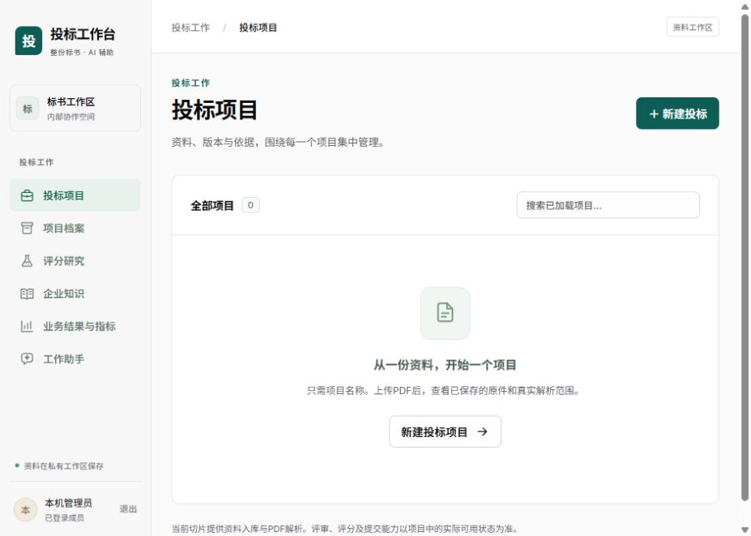

# Compose分组与接续验证

日期：2026-10-19。分支：`fusion/bid-workbench`。应用最终提交：`e5fb4d2`，前序`c4b30ca`、`120ad8f`、`38c4338`。

## 实际结果

- 六个侧栏入口各用语义线性SVG，尺寸／线宽一致。TypeScript、受影响ESLint、格式与生产构建通过；恢复浏览器后实际登录并在默认视口看见六种独立图标，截图见下。1440／手机专项尚未补验。
- 两个新库初始化入口共享有序SQL计划，先冻结全部UTF-8输入再连接。要求DDL按worker-functions→requirements→roles执行，随后独立撤销四张不可变历史表UPDATE，默认共12项。
- 固定Compose项目`tender-fusion`，默认postgres、init、api、web，检查为同组checks profile。PG不发布宿主端口；web仅127.0.0.1:5188。核心网络internal，只有web额外连接preview bridge；Docker29的internal-only网页实际不能发布宿主端口，已据实修复。所有服务不自动重启，复用已有镜像，没有零散临时容器。
- 新鲜预览代际fusion_v2已通过完整12项初始化，使用新库`tender_checks_fusion_v2`及独立init/api配置卷。旧预览库及旧配置卷保留，未隐式迁移、删卷或覆盖旧profile。初始化secret不挂API，API仅有专用配置卷；收费消费者未启动。
- 实测首页200、未登录401、登录200、会话200、异源403、缺CSRF403、退出204、退出后401。口令读取忽略目录secret，证据不含口令、cookie、CSRF或DSN。
- 最终同组Linux pure **70通过／0失败／0跳过，0.80秒**，含私有配置权限与初始化编排边界。最初70项0.87秒记录保留，不合并计数。
- 执行者最终真实PG／非owner ASGI **20通过，22.17秒**；主代理从整合12项计划独立再验 **20通过，22.28秒**。覆盖首版／追加CAS、历史原摘要、非法Unicode、最终过期409且零ACK、伪assessment、当前决定变化、NULL／整数／时间边界，以及决定空键两种赢锁顺序、无bids UPDATE的Worker继承、来源新别名真实锁等待。测试库和两个测试LOGIN已清理。
- 主代理本机整合纯领域／初始化／实际OpenAPI **35通过，2.45秒**。空应用、仅包路由、仅要求路由及主应用引用均检验；实际合同新增4路径6操作，旧路径和旧schema无语义变更。ruff／format、8源文件Linux mypy与bandit通过，前端生成后tsc通过。

检查结束已停止checks和checks-postgres，容器／卷保留。预览postgres/api/web健康，init退出0；原bidwb全部停止，后台自动接续关闭。

## 边界

要求记录仍是原rule_items与决定的不可变投影，不新增条款权威。旧规则未冻结完整抽取输入身份时仍为`unproven_legacy_rule_set`，清单完整性和review_ready保持false；人工范围声明不等于独立合规结论。旧清单／证据／包摘要不随当前决定或来源重建。

尚未覆盖要求页面、1440／手机图标专项、完整抽取身份、完整来源祖先／跨主体及坏历史矩阵、任意直SQL逆序锁死锁零ACK专项、正式整包评审／评分／提交链。不能将限定20项结果扩大成产品全部通过。

## 内置浏览器恢复

应用26.1013.4894.0今天启动日志显示浏览器后台ready，但当前对话的getInfo失败，明确报`No ChatGPT browser route is available for browser session`；昨天有当前对话的sidebar thread注册记录。此次无法发现浏览器的直接原因是对话路由缺失，不是后台未启动或网页访问失败。为何这次启动没有自动关联该对话，尚未证实。

通过应用工具`navigate_to_codex_page`重新打开当前对话，再请求打开5188预览。重新连接后，日志从同一getInfo路由缺失变为completed，控制接口取得iab浏览器。未重启／升级／重装应用，未修改配置或浏览器存储。

随后真实读取标签页、填写既有管理员凭据、点击登录并读取工作台成功，保存默认视口截图；页面保留为可继续操作的交付标签。若复发，先检查对话是否被桌面应用打开和关联；重开当前对话再连接，不应只反复刷新网页或直接归因项目／Docker。

Docker启动最初被残留socket阻塞，用户恢复后引擎29.8.2可用。没有改系统ACL或删除Docker数据。Windows符号链接权限失败未改成skip，相关Linux门已实际通过。初跑发现并修复DDL CASE括号、ON CONFLICT先触发INSERT守卫误拒追加，以及SELECT FROM空tuple误判角色不存在，最终回归覆盖修复后的候选。

## 证据

原始记录在[evidence](evidence/)：最终Linux XML、真实PG XML、本机35项XML、HTTP状态、12项初始化回执、启动时公开源码／dist摘要与实际镜像ID。`bid-package-requirements.executed.sql`保留本机实际执行字节，避免把Windows原文件摘要冒充Git规范摘要。启动摘要是只读挂载开发环境的时点观察，不是不可变镜像部署证明。
