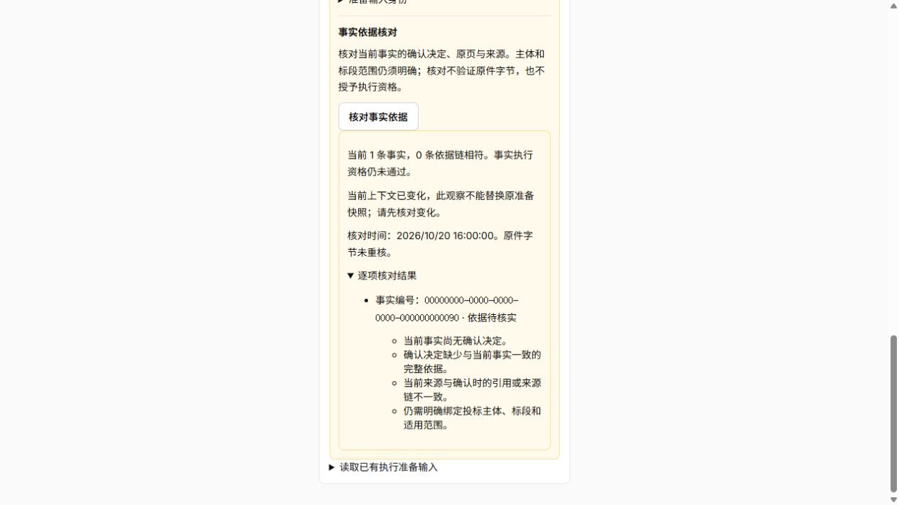
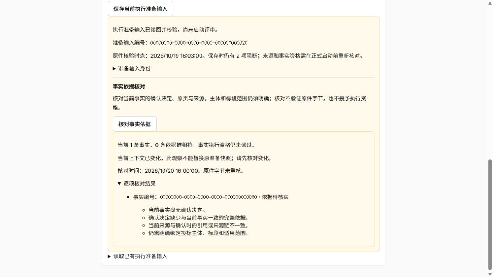
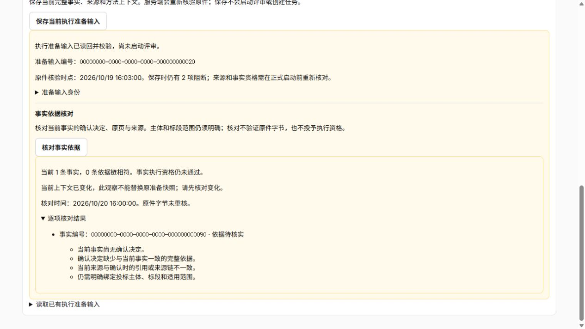

# 事实依据只读核对与界面验证

应用 `ecde4f9b9fc19a993f2fa2ef59d9c5b889295475`，分支 `fusion/bid-workbench`，预览5188／fusion_v5。准备输入工作面可显式核对当前事实的确认决定、精确原页与来源，逐项显示缺口。依据链相符与主体／标段适用范围分开，不授事实资格、启动或发布许可。

## 接口与责任

`POST /api/v1/bids/{bid_id}/packages/{package_id}/revisions/{revision_id}/requirement-inventories/{inventory_id}/frozen-review-inputs/{input_id}/execution-inputs/{execution_input_id}/fact-check`，请求仅 `execution_input_digest`。要求会话、Origin与CSRF，200返回只读观察，不要求幂等键，不建Command／任务／Outbox，不读原件对象。

同一RR只读快照先核原准备记录和明确摘要，再从原冻结选择读取当前上下文；观察显式携带prepared与observed context摘要及是否匹配，不能替换原准备快照。当前头或事实变化不会改写历史manifest、私有快照或旧报告。

- `bid_package_fact_validation`负责只读证据与来源采集。按选定冻结parse而非latest查原页及解析质量，核当前决定的直接／沿用身份、事实值与决定审计依据、精确来源引用及祖先闭包效力；不复用依赖current_body的编制资格。
- `package_fact_validation`负责纯比较并返回原因。缺决定／依据、原页在包外、解析或页缺口、来源引用／闭包变化、来源效力不足分别枚举。重复JSON键、非有限数值或损坏依据不能取得“依据链相符”。响应只含事实编号和状态／原因，不含事实值、正文、审计内容或对象定位。
- 自由文本subject／scope不能证明当前投标主体和标段，每项仍有 `FACT_SCOPE_MAPPING_REQUIRED`。即使依据链相符，`facts_qualified`、review_ready、launch_available及publication_authorized恒false；空集明确缺事实，不能当默认无事实要求。该入口是资格缺口核对，不是资格持久化或正式审核结果。
- 公开schema、实际OpenAPI和生成TS同步。原准备保存／读取协议不变，未修改冻结／准备表约束或版本。

界面只在已核对的准备记录下提供“核对事实依据”，不自动发送请求；显示数量、依据链相符数量、逐项原因、观察时间、原件字节未核及上下文变化提示。客户端核scope、记录与摘要、计数／唯一事实ID、已知原因、全部false边界及同上下文时的原事实摘要和计数；换准备记录后迟到响应不采纳。UI、响应核对及后端采集／纯比较分别分工，CSS仅作用冻结工作面。

## 最终验证

| 范围 | 结果 | 证据 |
| --- | --- | --- |
| 独立PG／非owner API | 131通过，163.63秒，新增5项，0失败／错误／跳过 | [XML](evidence/requirements-api.xml)、[日志](evidence/api.log) |
| 领域／编排／契约 | 133通过，2.25秒，新增20项 | [XML](evidence/domain.xml)、[日志](evidence/domain.log) |
| 完整前端 | 50文件、399通过，16.77秒，新增15项 | [XML](evidence/frontend.xml)、[日志](evidence/frontend.log) |
| Python门 | ruff／format7文件、mypy／bandit4源通过 | [ruff](evidence/ruff.log)、[格式](evidence/format.log)、[类型](evidence/mypy.log)、[安全](evidence/bandit.log) |
| 前端门 | 格式、零警告lint、类型和构建通过，入口499.39kB | [格式](evidence/frontend-format.log)、[lint](evidence/lint.log)、[类型](evidence/types.log)、[构建](evidence/build.log) |

真实PG验证无对象调用／新增业务写入、精确准备摘要／scope与CSRF、额外授权字段拒绝、当前事实变化但旧历史不变；非owner注册精确解析来源、真实决定及审计形成的正例可证明依据链，来源撤回后立即变为待核，正反例均不能授范围或执行资格。纯反例覆盖坏JSON／重复键／非有限值、事实身份变化、决定／范围／页质量／引用／来源链及效力变化；前端反例覆盖跨scope／记录／摘要、重复事实、计数／原事实摘要／未知原因／伪资格／原件标志／上下文与日期错配及晚到响应。

## 浏览器与部署

内置浏览器以真实组件及合成HTTP，完成保存／核对、展开逐项原因及上下文变化提示；1280×720视口下的390／768／1200px内容容器均无横向溢出，组件宽302／680／1112px，见[尺寸](evidence/dimensions.json)。不报手机设备或真实材料验收。验后重置页面夹具、关闭临时页，正式构建清QA。

API明确重启，固定Compose默认healthy、init退出0，checks与检查PG停止；独立检查库及两账号0，见[服务](evidence/services.txt)、[清理](evidence/cleanup.json)。没有DDL／权限变化，仍用v5并保留v4；非owner／非superuser只读核准备表只追加权限、项目／冻结／准备记录0，见[数据库](evidence/database.json)。未启动旧dev／Claude组，未改正常Word服务。

[实际API](evidence/runtime-api.json)核200／Origin／CSRF／恒false字段；[同源资源](evidence/deployment.json)核HTML、主JS／CSS、工作面懒加载JS及本轮修改的懒加载CSS字节匹配，819[运行输入](evidence/runtime-inputs.json)一致，无QA。开发只读源码挂载指纹不等同不可变镜像发布。[回执](evidence/receipt.json)关联源与证据。

## 接续

继续明确事实与主体／标段／包修订的范围绑定及其持久化、变更失效协议，再接要求完整性的权威验证、正式任务／阶段／Outbox／ACK及Worker。范围绑定与原准备身份须分开：不能用新增确认更改旧快照，也不能把本观察改称资格授权。真实存储／材料效果、供应商和独立评分配对另验，后台自动接续保持关闭。
