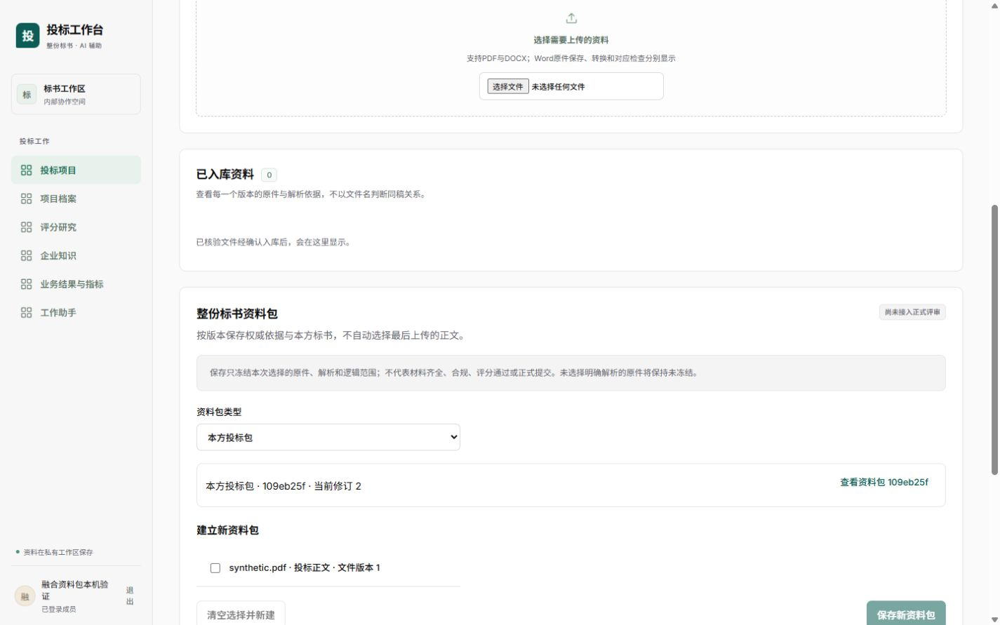
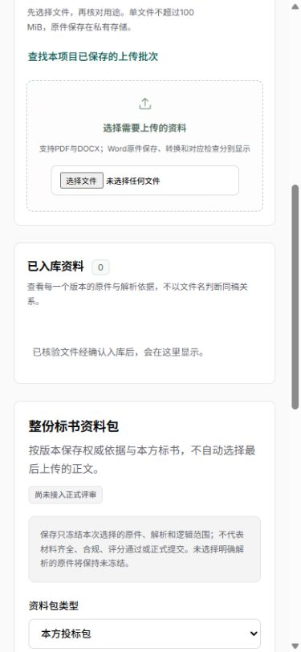

# 自托管字体本机验收

应用提交 `40f69ee` 复用固定供体 `45a5921011fa22f400482f73710e96a32b916082` 锁定的Inter／Noto Sans SC 5.3.0。没有安装新包或联网下载字体：本机已装包逐项与npm缓存tar原字节比较，缓存tar的SHA512与供体lock integrity一致。

保留Inter 7个、Noto Sans SC 101个原始normal可变字重分片，共4,735,020字节，100—900字重、Unicode-range与swap原样保留；两份OFL许可、原CSS、metadata及来源摘要随应用资产提交。没有按截图裁字，也不是全Unicode字库承诺。应用CSS仅改为同源 `/fonts/fusion/…` 地址，不请求第三方字体服务；浏览器按页面字符选择分片。

主代理独立核验121个来源／资产文件大小及SHA，并核应用CSS SHA一致。打包通过、全前端format通过；字体原始目录通过局部规则排除格式化，避免改变上游字节。

| 内置浏览器 | 实测 |
| --- | --- |
| 字体规则 | FontFaceSet.size为108；正文实际字体栈以Inter Variable／Noto Sans SC Variable起始 |
| 字符／字重 | 中文“整份标书资料包”900字重及拉丁“Tender 12345”的document.fonts.check均为true |
| 桌面1440 | 文档宽1425，无横向溢出 |
| 手机390 | 文档宽375，无横向溢出；关键说明换行可读，视口临时覆盖已恢复 |

记录见[桌面指标](evidence/desktop.json)、[手机指标](evidence/mobile.json)。仅检查字体名匹配不足以授装载资格，因此同时核对实际108条规则与字符检查；没有将空字体集合时的true误当成功。

本片只关闭精确字体来源及同源接入这一部分。全部模块的字号／密度、无系统中文字体环境、200%真实缩放和跨主题仍未验收，F12-02保持进行中。尝试浏览器快捷键未产生可测缩放，不把手机视口或字体字重检查写成200%缩放通过。未部署，生产CSP与完整页面验收继续分别验证。
