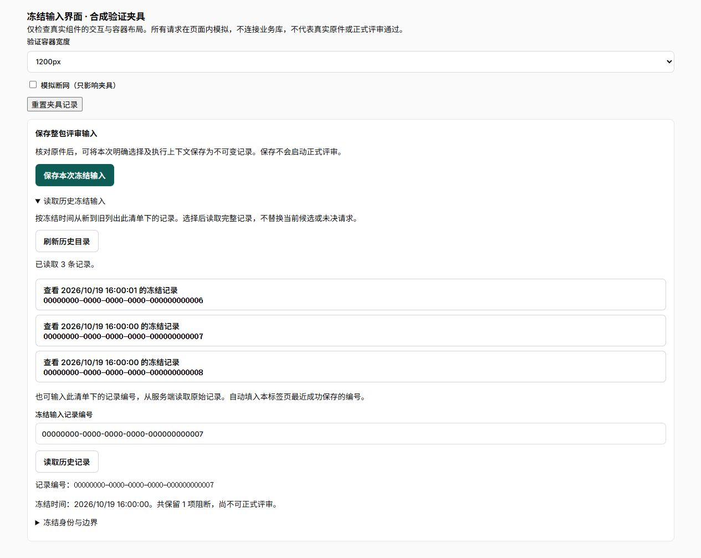
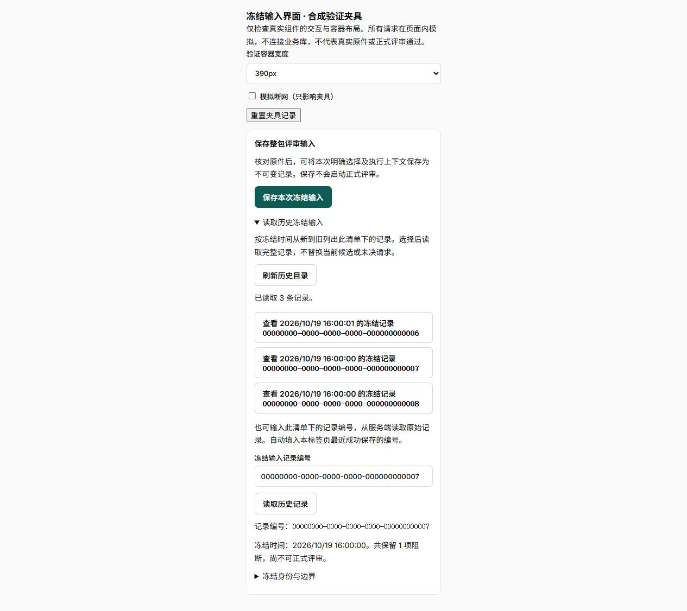

# 冻结输入历史目录与分页验证

应用 `949c78a`，分支 `fusion/bid-workbench`，本机预览 `http://127.0.0.1:5188`。冻结保存和原请求恢复依据见[前端保存验证](../frozen-input-ui/冻结输入保存与恢复界面验证.md)，不可变持久化依据见[后端冻结验证](../review-freezing/整包输入持久化与幂等冻结验证.md)。正式评审资格仍关闭。

## 接口与职责

新增 `GET .../requirement-inventories/{inventory_id}/frozen-review-inputs`，Session认证，每页默认20、最大100；按 `(frozen_at DESC,id DESC)` 排列，返回项目／包／修订／清单作用域及记录摘要、创建人、冻结时间、输入与上下文摘要。没有证据根、正文或对象定位，不启动模型、任务或原件读取。

独立 `bid_package_review_input_directory` 只核对不可变清单作用域、查询摘要并处理分页；HTTP层负责认证、边界及只读可重复读事务。复用既有签名游标，绑定完整四项作用域；时间键须带时区。损坏、跨清单、超长或非法时间游标422，错误作用域404，未认证401。不读当前包头、清单头、来源效力或对象存储，项目关闭、来源撤回后仍可查旧记录。已有API仅读／追加权限足够，没有DDL或权限补丁。

分页使用时间和UUID联合边界，不用偏移量。每个请求有自己的只读快照，并非跨请求长期快照：目录打开后保存的新记录由刷新首屏发现。没有历史总数或大规模性能承诺。

## 前端边界

- `PackageFrozenInputDirectory` 在历史折叠区域打开后才读取目录，负责首屏、手动刷新、更多页、错误与请求代次；`frozenInputDirectory` 独立核对作用域、摘要形状、顺序和分页边界。相同毫秒内保留微秒，完全同刻才按UUID降序。
- 不自动选择最新记录。明确点选后调用既有完整GET，并复核manifest规范摘要及所选目录条目的ID、摘要、创建人、输入／上下文和精确冻结时点。UTC的Z／+00:00表示可等价，微秒不同不能混同。按编号读取继续保留。
- 坏页、重复记录、倒序错误或游标A→B→A循环不追加；下一页失败保留已核对首屏，用户可重试或刷新。关闭／重新打开、切成员或清单均隔离迟到响应。
- 历史选择不改当前候选或未决保存请求。新保存成功后自动填入新编号并失效先前历史读取，旧慢响应不能覆盖新编号／详情；保存后若目录已打开，重读首屏。
- 实际OpenAPI、前端类型与可用接口表同步。读取目录不更改评审方法身份、冻结manifest或保存时阻断。

## 验证结果

| 检查 | 结果和证据 |
| --- | --- |
| 真实非owner PostgreSQL/API | [87项](evidence/requirements-api.xml)，104.44秒；[日志](evidence/api.log)。覆盖空目录、认证／四项作用域／数量边界、签名和时区／跨清单游标、历史头变化、顺序／分页、期间新保存与刷新、来源撤回／项目关闭／存储不可用后查询。 |
| 领域实际契约 | [12项](evidence/contracts.xml)，1.64秒，包含实际路由枚举。不是完整领域回归。 |
| 完整前端 | [346项／47文件](evidence/frontend.xml)，16.15秒；[日志](evidence/frontend.log)。包含目录顺序／微秒、坏页／重复／循环、晚到隔离、所选摘要／创建人／时点／输入／上下文匹配、成功只读选择及新保存与旧历史并发反例。 |
| 后端质量 | [ruff](evidence/ruff.log)、[format](evidence/python-format.log)5文件，[mypy](evidence/mypy.log)及[bandit](evidence/bandit.log)3源通过。 |
| 前端质量 | [格式](evidence/format.log)、[ESLint零警告](evidence/lint.log)、[类型](evidence/types.log)通过；[构建](evidence/build.log)2.28秒，入口498.67kB，保持500kB阈值。既有助手混合导入提示保留。 |
| 独立检查环境 | 固定 `tender-fusion` checks profile，无散落临时容器；[独立库和两个账号均0](evidence/cleanup.json)，检查服务停止。没有重复跑未变更的Linux初始化70项。 |

## 浏览器与视觉

内置浏览器使用真实组件与工作台构建样式，明确标注合成夹具。页面内模拟首屏两条、加载更多第三条及指定记录完整GET；逐条摘要／身份匹配，没有请求业务数据库。夹具源和复跑说明在 `apps/web/qa-previews/frozen-inputs`。

目录打开、分页、选中ID尾号7及完整记录展示通过。1200、768、390px容器的卡片及行均 `scrollWidth=clientWidth`，整页无横向溢出，见[测量与截图范围](evidence/visual.json)。这些是容器宽度，**不等同于手机视口或完整业务浏览器验收**。截图覆盖目录与选中展示；保存／历史并发反例由最终组件测试验证。

夹具记录已重置，浏览器回到实际预览；最终构建无 `_qa`。

## 部署与未验证事项

固定Compose部署同一v4，API已重启加载实际目录路由；[运行OpenAPI核对](evidence/runtime-api.json)确认新operation与分页schema注册。通过同源路径未登录请求返回401，入口JS／CSS／动态组件与本地构建逐字节相同，见[HTTP核对](evidence/deployment.json)。[API自身只读连接](evidence/database.json)确认仍为 `tender_checks_fusion_v4`、非owner、冻结表SELECT可用／UPDATE不可用，项目及冻结记录均0。没有新建或迁移业务库，也没有自动创建合成业务项目。

默认API／web／PG healthy、init退出0，checks与checks-postgres停止，见[服务状态](evidence/services.txt)。未启动旧dev或Claude测试容器，未改正常Word服务。[运行输入时点指纹](evidence/runtime-inputs.json)与[提交及证据摘要](evidence/receipt.json)已核对；这是只读源挂载开发部署，不是不可变镜像。

F01-06仍进行中。下一步是整包冻结证据的执行消费与发布前复核：从同一不可变根构造输入，保持精确包／解析／事实／方法／用途身份，不能接旧单正文入口绕过资格。事实来源资格、要求完整性、正式整包执行、评分／比较／提交、真实存储／材料和独立评分配对继续待验；目录与合成组件测试不授通过。
