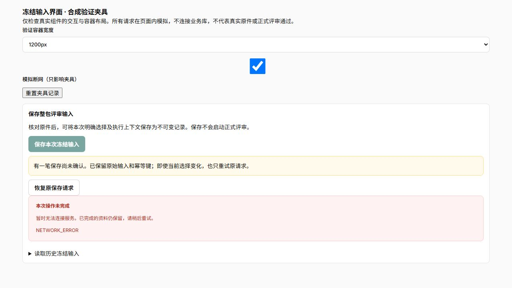
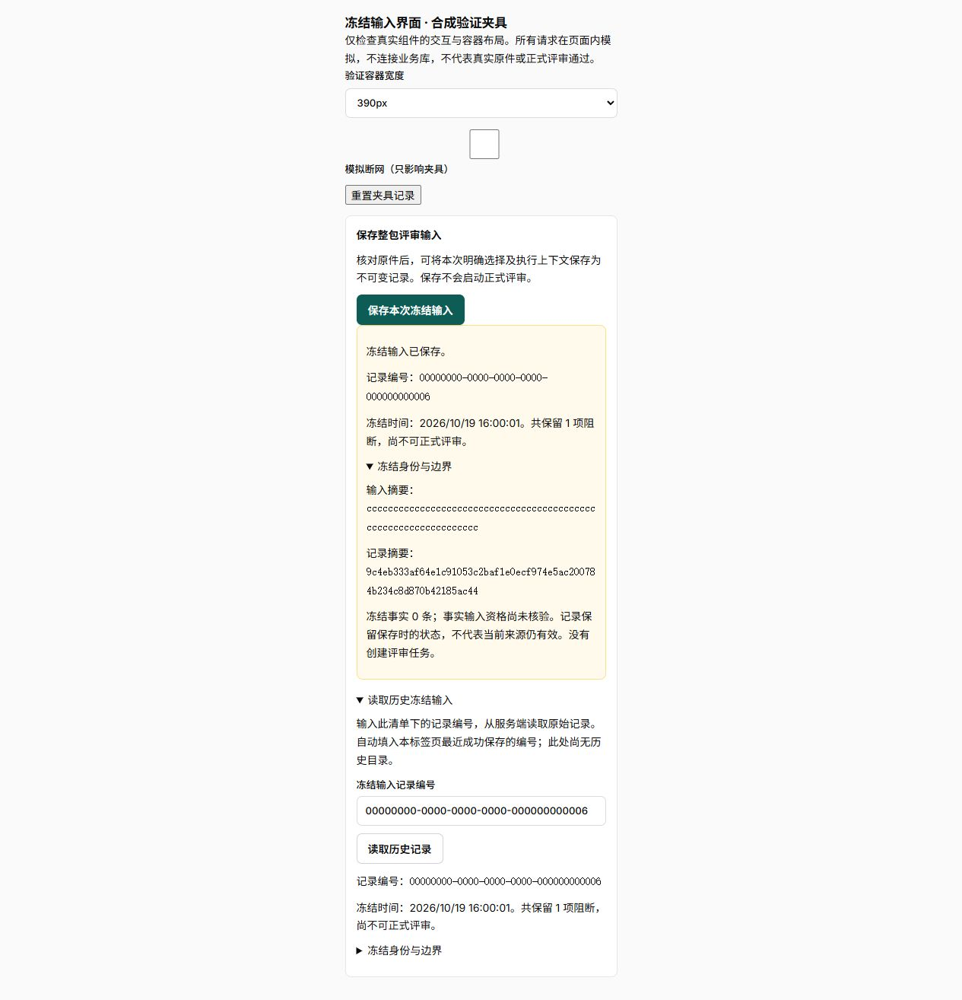

# 冻结输入保存与恢复界面验证

应用 `703fb7f`，分支 `fusion/bid-workbench`；预览 `http://127.0.0.1:5188`，继续使用 `fusion_v4`。后端持久化与权限依据见[整包输入持久化与幂等冻结验证](../review-freezing/整包输入持久化与幂等冻结验证.md)。本片不改后端、DDL、权限或正式执行资格。

## 交互与职责

- `PackageReviewInputPreview` 只将通过本次精确预检和原件核验的候选交给保存入口；重新预检／核验先撤销候选，不沿用旧观察。
- `PackageFrozenInputWorkspace` 协调显式保存、恢复及按编号历史读取；`packageFrozenInput` 独立处理严格请求结构、成员／项目／包修订／清单隔离、本地记录和完整回执身份／规范摘要校验。HTTP继续复用既有同源Session／CSRF及幂等键协议。
- 请求发送前先保存完整六字段body和随机幂等键；保存恢复记录失败时不发POST。网络异常、坏回执和未知后的通用4xx均保留原请求，不按当前头或新候选重建。仅首次明确上下文／输入变化或提交拒绝才释放该次请求。
- 读取原清单即可显示未决恢复，不要求先重做预检；刷新后需重新选中同一包修订与原要求清单。不同成员和清单互相隔离；切换／离开后晚到响应不能清理原未决记录或影响新页面。退出登录及成员切换纳入现有恢复记录清理路径。
- 成功ACK核对actor、完整scope、输入／上下文摘要、候选资格、精确时点、阻断及manifest规范SHA256后，才清除未决并保存最近成功编号。最终冻结时点可晚于原件观察，不错误要求旧观察的snapshot_digest不变。
- 历史入口为显式编号GET，并自动填本标签页最近成功编号；**没有服务端历史目录**。每次读取验证实际服务端manifest、记录编号、作用域和摘要，历史创建人可以是其他成员；不要求当前可写或已有候选。记录只表示保存时的状态，没有启动正式评审。

## 测试和质量门

- [完整前端326项／46文件](evidence/frontend.xml)通过，16.24秒；新增27项覆盖请求恢复／回执、原件观察回调及不依赖预检的恢复入口。计数不与下面专项相加。
- 最终组件／样式收尾后，[受影响50项／3文件](evidence/final-affected.xml)复验通过，4.40秒。[日志](evidence/final-affected.log)。包括丢失ACK刷新同body／key、未知后400／401／403／404／409／422／428／500、错误身份／摘要／资格／阻断、存储失败零POST、恢复记录损坏及跨scope拒绝、退出清理、离开后晚到响应隔离。规范摘要使用Python生成的中文／非BMP值固定向量交叉核对。
- [格式](evidence/format.log)、[ESLint零警告](evidence/lint.log)、[TypeScript](evidence/typecheck.log)、[生产构建](evidence/build.log)通过。入口498.54kB，保持现有500kB阈值；独立动态组件和独立作用域CSS。既有助手混合导入构建提示保留。
- 未改后端，本片没有重复运行前片PG/API84项或领域57项，不将旧计数当本批结果。无临时测试库、账号或新容器。

## 内置浏览器与视觉边界

使用真实保存组件、实际构建后的工作台样式和明确标注的合成界面夹具；页面内fetch模拟断网、原ACK及历史响应，**没有连接业务库，也没有核验真实原件**。可复跑源码位于 `apps/web/qa-previews/frozen-inputs`，说明包含构建与清理命令。

内置浏览器显式保存后显示未决，切换模拟网络后恢复成功，并读取同编号历史；长摘要折叠／展开正常。1200、768、390px容器分别检查，[测量](evidence/visual.json)中卡片scrollWidth等于clientWidth，整页没有横向溢出。**这些是容器宽度，非手机视口验收**；完整工作台断点及真实业务浏览器链仍待验证。

夹具记录已重置，浏览器回到实际登录入口；最终普通Vite构建已移除 `_qa`，夹具不进入最终预览资源。

## 部署与后续

继续固定 `tender-fusion` Compose和现有v4，未新建／迁移库，未写业务资料。默认API／web／PG healthy、init退出0，checks及checks-postgres保持停止，见[状态](evidence/services.txt)。未启动旧dev或Claude容器，未改正常Word服务。实际登录入口可见；实际HTTP返回的入口JS／CSS／冻结输入动态块与本地构建逐字节一致，运行输入指纹逐项匹配，见[部署核对](evidence/deployment.json)和[运行指纹](evidence/runtime-inputs.json)。首两次沙箱探针在请求前被环境TLS日志路径／套接字权限阻止，授权只读本机HTTP探针通过；无产品改动或放松认证。

源码／证据摘要见[回执](evidence/receipt.json)。F01-06仍进行中；下一步补服务端冻结输入目录及其分页／历史选择，再接消费完整冻结身份的执行与发布前复核。事实输入资格、要求完整性、正式评分／比较／提交仍未授通过；真实材料、对象存储和独立评分配对尚缺，不以本片合成组件验收替代。
