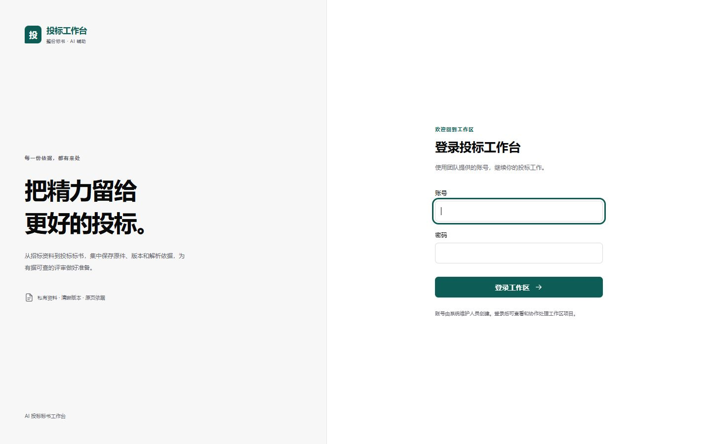
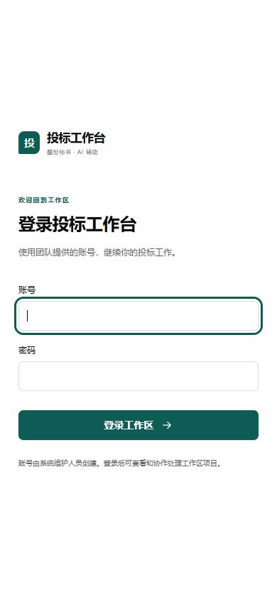

# 视觉令牌与登录页本机验收

应用候选 `8bcf96d01b095b4de5a240ec83868db94632eab0`，融合页面由本机独立Vite回环预览提供，未切换原8080。使用内置浏览器实际检查当前融合页，没有用供体截图替代。

32个语义令牌采用固定供体 `45a5921`；5个旧变量兼容映射保持原语义。`--muted`实际解析为次级文字 `#63636b`，没有误用供体同名的背景值。品牌及主动作 `#0d5c55`，AI使用独立靛蓝；样式来源、适用组件和未改业务专色详见应用 `workbench/docs/fusion-visual-tokens.md`。

| 检查 | 实际结果 |
| --- | --- |
| 静态颜色 | 15组正文＋2组焦点对比度通过；最低正文5.396:1。仅覆盖指定配对，不授整套WCAG资格 |
| 桌面 | 1440×900：品牌、登录字段及按钮完整可见；默认1280×720也未见横向溢出 |
| 键盘 | Tab由账号进入密码，实际3px solid焦点可见，未输入账号或凭据 |
| 手机 | 390×844：表单实际left26／right364／width338，左右留白各26；文档宽390无横向溢出，登录按钮在首屏 |
| 发现与修复 | 手机grid自动最小轨道使表单超出面板内容宽度，已改minmax(0,1fr)及min-width:0；原截图保留，修后独立重测 |
| 品牌 | 主品牌“投标工作台”，副标“整份标书 · AI 辅助”，不再限制为市政或施组 |
| 前端质量 | 主代理独立复跑148项／37文件、lint、typecheck、format及生产build均通过 |

## 实际截图

桌面：

手机修复后：

修前原图为 `evidence/f12-login-mobile-before.jpg`。临时视口覆盖在验收后已恢复。

## 验收边界

本批为基础浅色令牌、共用表面／状态规则、登录外观和手机具体缺陷；未完成所有模块的交互或视觉统一。真实项目内危险／待核／成功及AI状态的全部动态组合尚未做浏览器验收；没有把静态颜色计算写成业务检查通过。

预览没有连接融合API进行登录，不把截图称整包业务端到端成功；真实登录／目录接口的独立ASGI结果见[G1验证](../g1/稳定标段身份与接口验证.md)。字体包与密度、深色／浅色／系统主题、全局导航、右侧助手及编辑器布局仍按F12后续任务推进。正常Word和原业务服务保留，未调用付费模型。

原始对比度JSON、五项质量门日志和截图SHA清单见 `evidence/manifest.json`。
