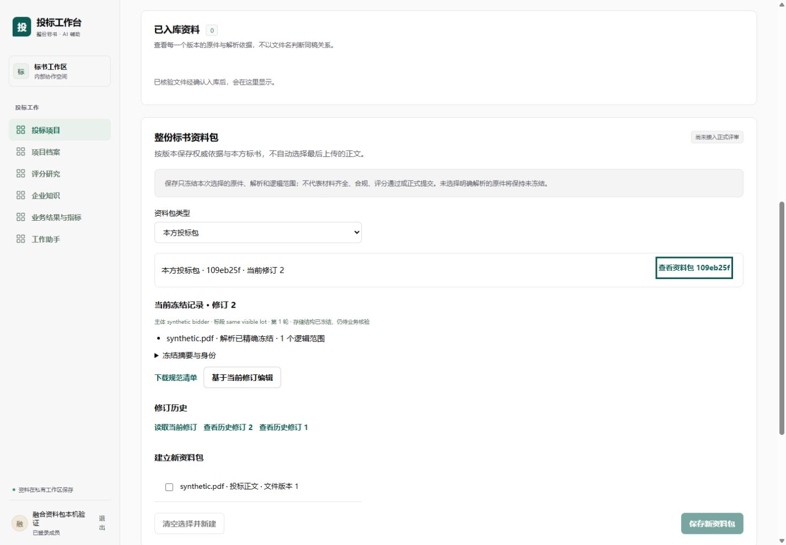
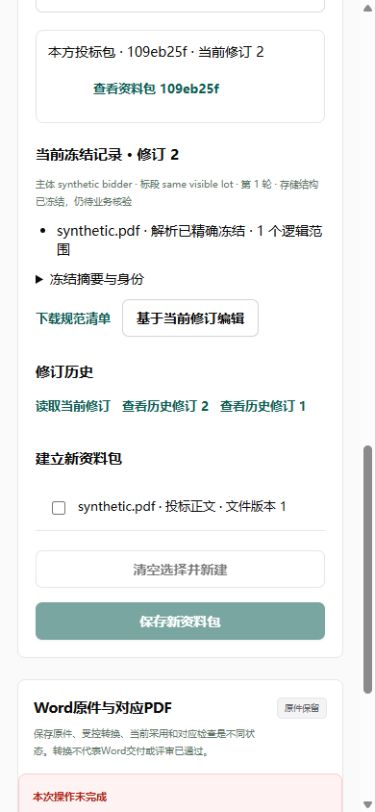

# 资料包工作面本机验收

应用提交 `d7da5da` 将不可变资料包接入项目资料页，并提供文件版本、明确解析、用途、逻辑页段、历史修订、规范清单与并发冲突处理。发现接口固定提交及49项独立验证见[接口记录](../package-api/资料包修订接口验证.md)。

## 浏览器真实交互

本机独立Vite 5173与真实main API 8800，只绑定回环。数据库为专门的 `fusion_browser_package`，API使用单独非属主LOGIN；未切换原8080、连接业务库或传入供应商密钥。账号、会话、CSRF、目录、保存及读取均由真实API处理。

1. 实际登录并从项目列表进入合成项目资料页，从所有已提交文件版本目录选择原件。
2. 未选择解析时保持未知页数；解析下拉列出明确run与时间／覆盖，partial选项禁用，未自动选择最新run。
3. 输入资格、商务、技术三个用途，明确选择完整解析与物理页1—2，保存第一修订。
4. 刷新页面后从目录重新发现包，基于当前head编辑，将范围改为1页并保存第二修订。
5. 回看第一修订，仍读取其独立历史清单；只读数据库重算两份规范JSON SHA均匹配。第一版仍为原类别及两页，第二版为修改后的类别及一页，实际摘要见[持久化回执](evidence/package-browser-persisted.json)。

本例原件、上传完成元数据和解析页是明确合成fixture，没有实际上传PDF、OCR或OSS。旧资料区域未设置current_material指针而显示0，整包目录可发现已提交版本；不把两种范围当成数量不一致缺陷。测试profile没有启用Word接收，页面明确显示未配置，不以该profile验收Word能力；正常业务Word服务保留。

## 未决保存反例

交叉评审使用真实组件及api.ts发现：失ACK后允许改稿，会替换原幂等键，再改回原内容可能重复建包。现先按成员及项目在sessionStorage保存完整payload、key、If-Match，再发送；结果未知时锁编辑、清空和类型切换，只允许明确重试原请求。刷新恢复原操作，不自动采用新head。503、未知后401不推定原保存失败；存储失败则不发送。损坏或跨范围恢复记录阻断新增，服务器仍核原请求及身份权限。

| 检查 | 实际结果 |
| --- | --- |
| 完整前端 | 执行者161项／38文件全部通过；lint、typecheck、build通过 |
| 主代理独立专项 | 新组件13项全部通过，覆盖精确解析、未知、分页、历史、412留稿、网络原键、刷新及成员／项目隔离 |
| 交叉独立审查 | 原13项加3个独立反例，共16项通过；新增损坏JSON、记录内部bid错配、跨bid返回原未决字节 |
| 格式 | 主代理生成类型格式化后，全前端format检查通过 |
| 视觉 | 桌面1440及手机390实际检查；新面板补留白／fieldset边界、长文本换行及历史按钮间距 |
| 手机范围 | 390视口，包left18／right357，文档宽375，无横向溢出；临时视口已恢复 |

组件失败／网络反例使用明确合成HTTP响应。浏览器验证覆盖正常创建、修订、刷新及历史读取；没有在浏览器中注入失ACK或模拟真实供应商失败，也未验证浏览器下载落盘。

## 截图

页面明确“尚未接入正式评审”。存储冻结不代表要求齐全、合规、评分通过或正式提交；要求清单／覆盖与整包正式业务链继续单独实施。原始专项JUnit、交叉审查JUnit、持久化回执及图片SHA见 `evidence/manifest.json`。
