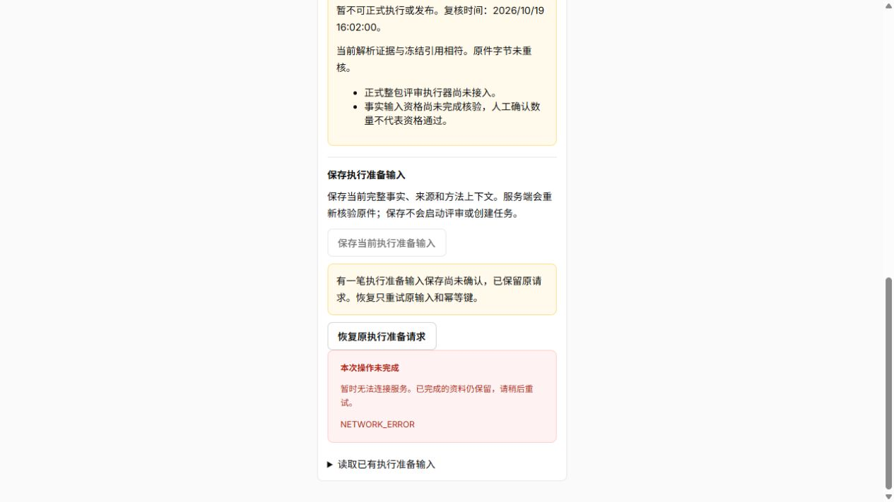
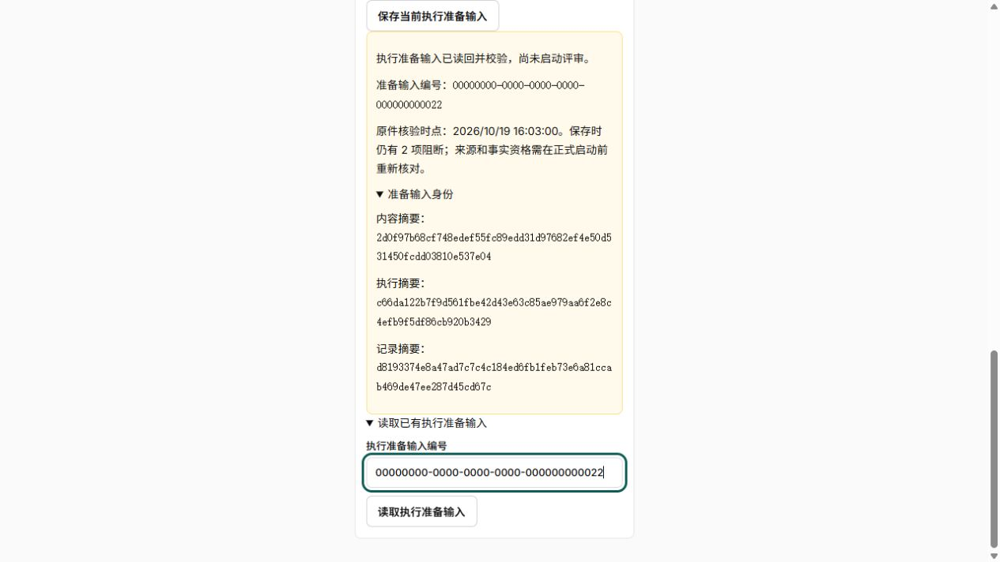
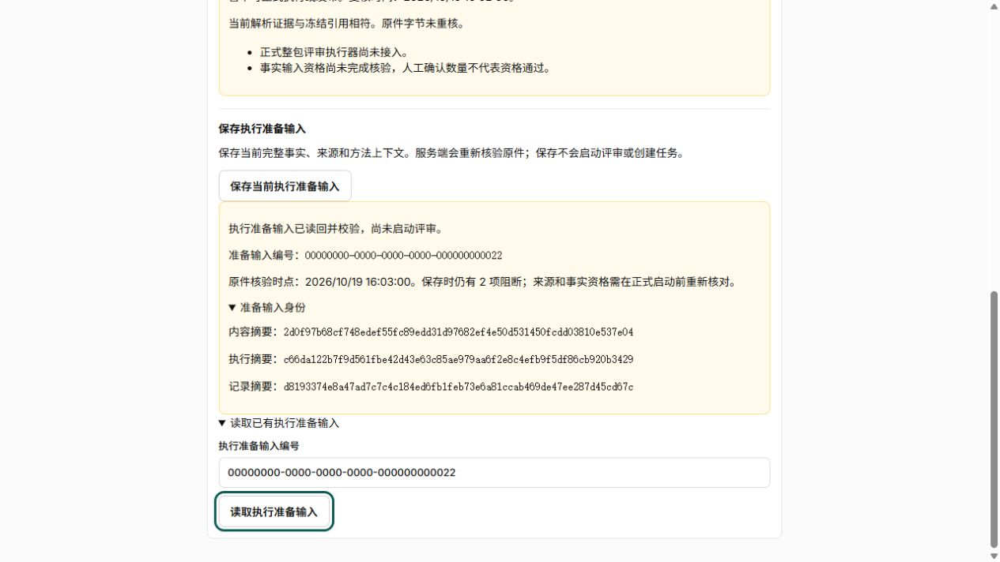
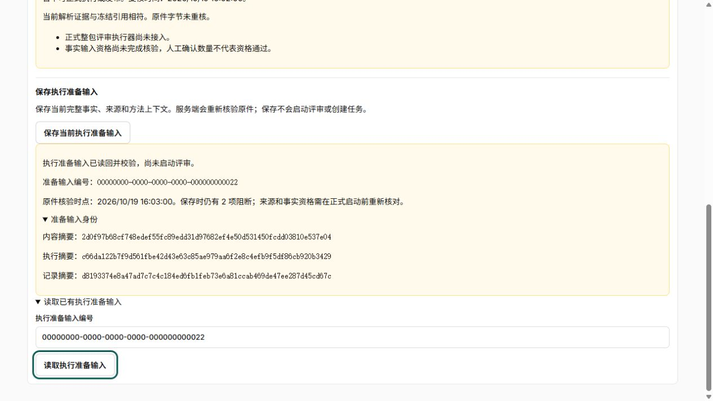

# 准备输入交互与窄容器验收

应用 `5ccfae2e674c0143bfb35ce485a455656ffe4eb8`，融合分支 `fusion/bid-workbench`，已部署同 `http://127.0.0.1:5188`／fusion_v5。保存、恢复和精确历史读取的主行为见[界面保存与恢复](../prepared-input-ui/执行准备输入界面保存与恢复验证.md)。本专项补真实浏览器交互与容器布局，并修复保存结果的展示竞态。

## 结果与修正

在真实组件的合成页面依次保存冻结输入、复核条件、保存准备输入、模拟断网、恢复、按编号读历史。实测发现第二次保存未确认时仍显示上一笔成功结果，容易将旧记录读成当前保存成功。新保存开始即清除旧结果，并使此前未完成的历史请求失效；原历史ID仍保留，用户可显式重新读取。没有删除成功记录或未知请求，也不自动换幂等键。

新增两项回归分别覆盖“新保存未知时隐藏旧成功”和“保存开始后迟到历史响应不能覆盖未知状态”。完整前端49文件384通过，15.63秒，0失败／错误／跳过，见[XML](evidence/frontend.xml)、[日志](evidence/frontend.log)。[格式](evidence/format.log)、[零警告lint](evidence/lint.log)、[类型](evidence/typecheck.log)和[构建](evidence/build.log)通过，入口499.19kB。没有后端、契约、SQL、权限或CSS变更，不重复计算既有后端测试为本轮新验证。

## 真实浏览器验收

使用内置浏览器，视口1280×720 CSS像素，切换390／768／1200px内容容器；这不是手机视口或设备模拟验收。组件实测宽度分别328／706／1138px。文档宽1265px，未超视口；每种状态下准备输入区域及后代均未发现横向溢出，见[尺寸与焦点](evidence/dimensions.json)。

- 390px：断网后新保存禁用、原请求恢复可用，未知提示与网络错误明确；旧成功结果不再混在当前未知状态。恢复后成功提示仍明确“尚未启动评审”，64位摘要自然换行，输入框和按钮在容器内。
- 768／1200px：成功记录、展开身份摘要和历史编号入口布局正常，长摘要不穿出边框；键盘Tab可进入读取按钮，可见3px焦点轮廓。
- 真实刷新：未知保存后刷新页面，再通过“读取历史记录”显式打开原冻结输入，未重新复核候选也可恢复原准备请求；新保存仍要求当前候选。没有读取浏览器私有存储来替代UI操作。
- 保存后按编号读回成功；所有资格和启动标志仍false，无正式启动按钮。

截图为实际可见视口，页面上方内容可通过正常纵向滚动查看。初次整页截图失败，使用插件支持的视口截图完成；不宣称整页捕获成功。[过程说明](evidence/intermediate.json)保留该限制。

夹具中的断网发生于模拟服务提交前，不是“真实服务已提交但ACK丢失”的端到端验收；后者依赖后端既有幂等机制及专项验证。夹具全部HTTP在页面内模拟，不连接业务库，不代表真实原件、OCR、事实或评分质量通过。验收后通过页面按钮重置夹具记录、关闭临时标签，正式构建清除`dist/_qa`。

## 浏览器重启失联边界

插件384文件完整。应用诊断明确为当前对话缺少browser route，重新导航实际任务并打开预览后出现sidebar注册、route capture及host创建，实际页面读取／输入／截图恢复。当前安装渠道更新检查为up_to_date。已加入按需自动恢复的长期指引，不改应用二进制、插件控制组件、浏览器个人数据或安全设置，不建开机任务／后台自动化。具体事件见[诊断摘要](evidence/browser-recovery.json)。这解决当前连接并固定规避流程；未证明应用内部启动缺陷已根治，未重启电脑复验。

## 部署与接续

固定Compose配置通过，默认api／web／postgres healthy、init退出0，检查服务及检查PG保持停止，见[服务](evidence/services.txt)。[只读数据库](evidence/database.json)仍为v5、非superuser／非owner，准备表SELECT／INSERT可用而UPDATE／DELETE不可用；项目／冻结／准备记录均0，v4保留。未启动旧dev／Claude组、未改正常Word服务。

[同源部署](evidence/deployment.json)核HTML、主JS／CSS与冻结工作面懒加载块逐字节匹配，未登录条件复核401，QA不存在；[运行输入](evidence/runtime-inputs.json)816文件匹配。开发源码只读挂载的启动观察不是不可变镜像发布。[回执](evidence/receipt.json)关联代码和证据。

本片关闭准备输入工作面的指定容器／状态验收缺口，未覆盖整站所有模块、手机视口、缩放和主题。F01-06继续正式启动资格重查、已准备输入绑定、原子任务／Outbox、Worker／fence与报告适配；不能通过删除EXECUTOR_NOT_READY或改prepared标志开放执行。后台自动接续保持关闭。
