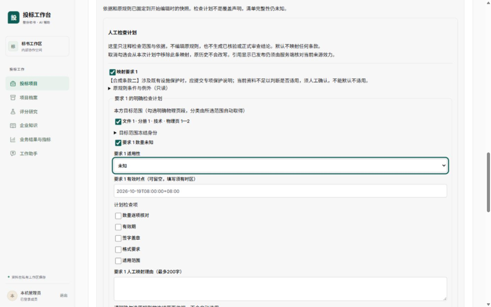
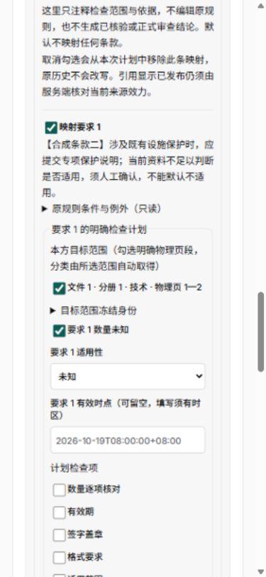
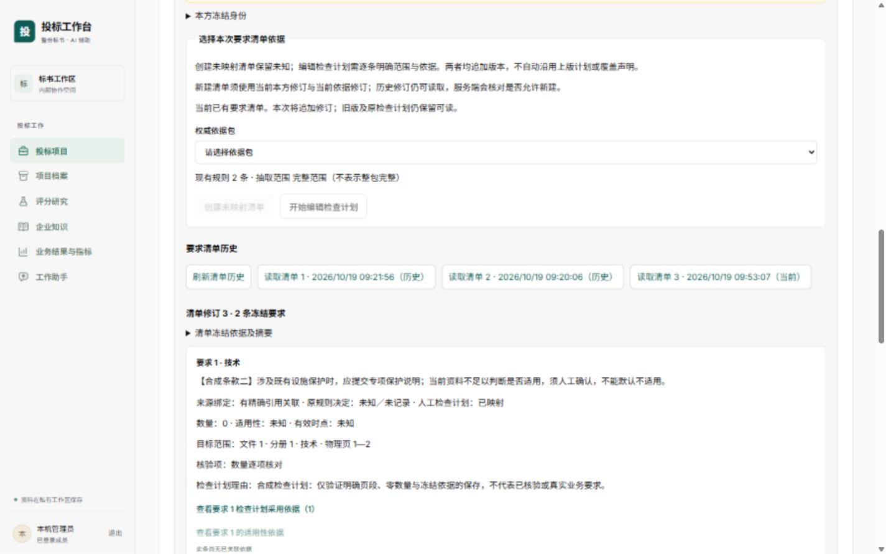

# 人工检查计划与样式隔离验证

本片在明确本方资料包修订内提供人工检查计划编辑及精确依据选择，沿用现有要求清单修订接口。实现范围以[融合实施计划](../../../00-项目管理/标书工作台融合实施计划.md)、[融合详细设计](../../../05-技术与设计/融合详细设计.md)及本报告为准。此前未映射清单、只读历史和负向覆盖观察的验收见[要求清单工作面验证](要求清单工作面验证.md)；该报告的既有测试计数与截图不能代替本片新实现的验证。

## 实现范围与资格

人工计划在原工作面内展开，不新增全局浮层或第二套规则权威。每条原规则默认未映射，只有明确启用并完成范围、理由和依据选择才形成映射；不自动勾选全部要求，不默认采用全部证据。原条款、条件与例外只读。未启用条款保持未知，空映射不等于全部适用或全部通过。

目标范围来自本方明确修订内的逻辑分册与物理页段。界面以文件／分册序号、分类及页段表达，冻结文件版本、解析身份和标题路径在身份详情内保留。共享附件可同时选择多个合法分册，分类按所选范围去重，不缩减为单一归属。

数量未知与明确的零分别保存为 `null` 和 `0`；明确数量同时声明计划核对数量，不表示核对已经完成。负数、非安全整数、无效带时区时点及不合要求的理由不能形成可提交计划。适用性保留“未知／适用／有据不适用”；有据不适用必须单独明确选择适用依据，不能用一般映射依据自动替代。

本片保存的是人工检查计划注释，不新增原规则或原决定，不写正向覆盖结果，不产生正式评审、评分或提交结论。旧规则集没有冻结完整抽取解析身份的事实保留，不能按时间推算并冒充当时精确冻结；人工映射不将 `inventory_complete` 或 `review_ready` 提升为真。

## 精确证据与历史边界

证据候选仅来自对应原规则的 `evidence_ids`，逐项请求 `/evidence/{id}`。选用前核对响应证据 ID、文件版本、明确冻结的解析 ID、正整数物理页及物理页落在所选依据包冻结分册内，并要求来源已发布。候选、撤回、读取失败或身份不符的引用不可选择；身份不符时不展示原句，防止以错误正文辅助判断。

编辑器不使用按文件查询最新解析的接口，不复用只具有正文编写资格的引用接口。没有证据不视为已绑定来源；页面显示已发布也不能取代保存时服务端对当前来源效力及范围的复核。

保存追加新的要求清单修订。历史读取仍使用既有冻结正文及摘要，不将当前规则、解析、来源状态或新映射重拼为旧清单。原包修订、原证据、旧清单和旧报告的字节与校验值不可因本片编辑而被改写。历史不可变的既有机制与此前实际验证见[工作面验证的合成夹具与边界](要求清单工作面验证.md#合成夹具与边界)；本片实际追加第三版后，从同组 API 的非 owner 连接独立读取并重算规范摘要：前两版完整规范正文（6031／6093 bytes）及原范围声明（1391 bytes）逐字节相同；第三版为6279 bytes，摘要 `5a0346e72ff5fe9835cc9bdb21187723c3d66eabaef43e43a7ce15e8cd616244`。原始三版正文与独立比较回执见 `evidence/check-plan-canonical-manifests.json`、`evidence/check-plan-immutable-comparison.json`。

## 草稿、失去响应与并发版本

开启编辑时捕获本方包、依据包修订、原规则集及版本条件，子组件使用稳定的初始映射快照。条件变化保留原草稿并锁定，不能自动切换依据包、最新规则或最新解析；旧范围迟到响应不替换当前证据状态。取消未发送计划与放弃已明确失败计划有明确入口，结果未知时不能丢弃原请求另发新键。

会话存储按成员、项目、包及包修订隔离，保存完整原请求正文、幂等键和首版／追加版本条件。旧 `version:1` 未决记录只允许恢复空映射；`version:2` 同时恢复所捕获依据与规则上下文及原映射。记录损坏、范围不符或恢复条件不合法时锁定创建；存储失败时不发送请求。

失去响应后以原正文、原键、原版本条件恢复核对，不自动重试。已有未决操作遇通用前置 409／422／428 不据此解除未知状态；仅按明确业务拒绝处理原操作。项目关闭仍允许原键取得既有 ACK，新操作禁用。

CAS 冲突保留原计划。用户先读取当前清单基线，界面核对其明确身份、包修订、摘要及版本条件，再由用户确认采用该基线；采用只更新版本条件，不改变草稿正文或自动提交。核对后如又有并发写入，仍由服务端版本条件拒绝，不能保证一次核对后永不冲突。

## 样式逃逸原因与修复范围

原页依据弹层由 `EvidenceLinks` 内联渲染在要求历史 DOM 中，并未移出资料包祖先。仅增加 `.package-requirements` 等前缀不能隔离其后代：祖先对 `label`、`article`、`p`、`details`、按钮等通用元素的规则仍会命中证据弹层。主代理在旧构建中实际量得物理页选择器变为 grid，引用卡片被设置为 16px 内边距、白底及边框，段落块方向边距变为 10px。这是实际后代命中问题，不是截图推测。

修复限定资料包／要求工作面的后代规则，排除 `.dialog-backdrop` 及其完整子树，同时将嵌套编辑器子树从父工作面通用规则中排除。600px／650px 移动分支采用相同边界；父工作面自身需要的 fieldset／legend 边框与文字样式显式保留，避免依赖祖先样式。子编辑器样式全部限定于 `.requirement-check-plan`，使用语义令牌，通用后代规则排除证据弹层；直接子 article／label 规则按当前 DOM 不命中弹层内部。

修复未重排原证据弹层或全局组件。祖先 `overflow-wrap:anywhere` 仍可被辅助文字继承；引用正文、标题及身份字段本已有明确换行规则，静态审查尚未发现由此导致的实质回归。这不等于宣称任意未来 DOM 或全部继承属性已被隔离。

## 审查与实际验证

独立只读审查已核对精确证据的 ID／文件／解析／页范围／发布状态检查、坏引用展示边界、异步清理、上下文变更锁定、恢复映射绑定、零与未知以及不适用独立证据。已核对当前实际 DOM：历史证据入口位于普通 article／div，未置于禁用 fieldset；当前子编辑器只以内联原句展示证据，不内嵌原页弹层。已核对父工作面与编辑器桌面、移动选择器边界，未发现新的实质阻断。此处为代码与 DOM 审查结论，不冒充独立执行全部测试。

应用提交 **67751d1**，已推送 `fusion/bid-workbench`，未合入 main。沿用现有 Node 22.23.2、依赖及固定 `tender-fusion` Compose 组；未装软件、未新增临时容器、未修改后端／DDL。预览入口为 `http://127.0.0.1:5188`，最终实际加载 `index-CQ9XQ5Ew.js`／`index-BrjcAY9F.css`，启动源码／dist／镜像指纹见 `evidence/check-plan-runtime-inputs.json`。API、数据库与网页健康，checks及checks-postgres保持停止。指纹是开发挂载时点记录，不冒充不可变镜像发布。

| 验证项 | 实际结果 | 原始证据 |
| --- | --- | --- |
| 编辑器专项 | 执行者17项通过；精确解析、错文件／越页、共享范围、多分类、0与未知、不适用独选依据、过期响应与恢复 | `evidence/check-plan-editor-17.xml` |
| 父工作面专项 | 执行者36项通过11.19秒，使用真实子组件；含v2原键／CAS恢复、通用422／428保守锁、412精确读取与确认、异域恢复拒发、规则变化保稿和历史中文读回 | `evidence/check-plan-parent-36.xml` |
| 完整前端 | root独立执行41文件233项全部通过15.52秒，包含以上专项，不相加。后续最后一处仅CSS复选标签两列对齐，已另行格式检查、重建及双视口浏览器验证 | `evidence/check-plan-full-233.xml` |
| 前端质量门 | 全format／ESLint／tsc通过；最终Vite生产构建通过2.16秒。既有AssistantWorkspace静态／动态混用分块警告仍在，不影响构建成功 | 实际命令见下文，最终dist指纹同上 |
| 真实接口与浏览器 | 合成项目明确依据→开启→逐条选择本方页段／精确证据→保存第三版→刷新重开；数量0、另一条未知、原理由、中文核验项与计划采用依据读回一致。第三版未写范围声明，全部核验仍未知 | `evidence/check-plan-saved-desktop.jpg`、规范正文与独立回执 |
| 桌面与手机视觉 | 1440×900／390×844；实际clientWidth分别1425／375，均与scrollWidth相同。18px复选控件为主题青色；手机长标签两列换行，操作按钮留隙。最后未发送视觉草稿已取消，默认viewport已恢复 | `evidence/check-plan-desktop.jpg`、`evidence/check-plan-mobile.jpg`、`evidence/check-plan-browser-layout.json` |
| 证据弹层 | 从计划采用依据实际打开；页码选择grid→flex；引用padding16→14px、白底→自身252/253/252背景，段落margin10px→自身8px上边距。DOM/CSSOM量得三类祖先选择器命中弹层后代为0；换页、390弹层宽390无横溢、关闭后焦点归原入口且body滚动恢复通过 | `evidence/check-plan-dialog-before.jpg`、`evidence/check-plan-dialog-desktop.jpg`、`evidence/check-plan-dialog-mobile.jpg`及量测JSON |
| 历史不可变 | 新第三版只有一条映射且count=0，未启用条款未知；前两版与原范围声明规范bytes及SHA均未变，完整性及正式审查资格仍false | `evidence/check-plan-canonical-manifests.json`、`evidence/check-plan-immutable-comparison.json` |

root执行命令使用已有Node直接调用 `node_modules/prettier/bin/prettier.cjs --check .`、`node_modules/eslint/bin/eslint.js .`、`node_modules/typescript/bin/tsc -b --pretty false`、`node_modules/vitest/vitest.mjs run --reporter=dot --reporter=junit --outputFile.junit=../../.local/check-plan-full.xml`、`node_modules/vite/bin/vite.js build`。实际部署复用 `./deploy/fusion.ps1 -Action up`；规范正文只读导出使用组内现有API容器和API非owner身份，host以独立hashlib计算SHA256，不使用owner修权限。

桌面编辑与手机换行：

保存后读回：

## 验证限制

浏览器准备资料为合成元数据，不代表已上传真实 PDF 或具备真实原件下载能力。精确 ID 与页范围检查通过，也不能据此声称原件下载、原页视觉对照、OCR、表格解析或抽取质量通过。此次弹层明确返回 `OBJECT_STORE_NOT_CONFIGURED`，只能验证合成解析文本、弹层布局与控制；真实取回／下载按钮未完成验收。

本片不覆盖正式整包评审／评分／提交链，不验证真实供应商或模型请求。真实最终提交稿与官方技术分配对资料尚缺，不能以合成计划验证替代独立精度验收。浏览器断网失 ACK、全部字号／缩放及所有业务模块的样式范围，如无相应实际证据亦不得写为通过。
