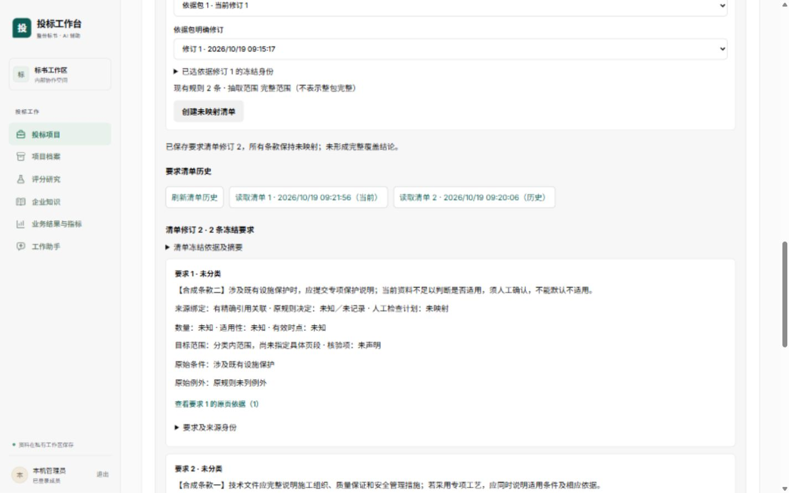
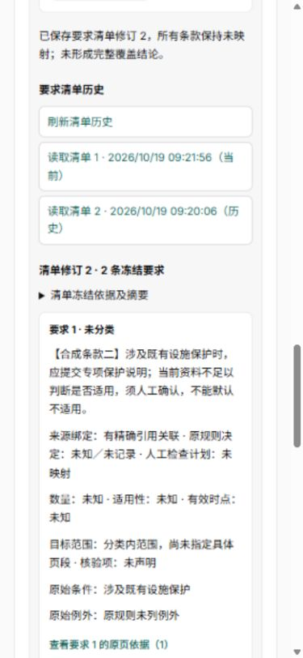
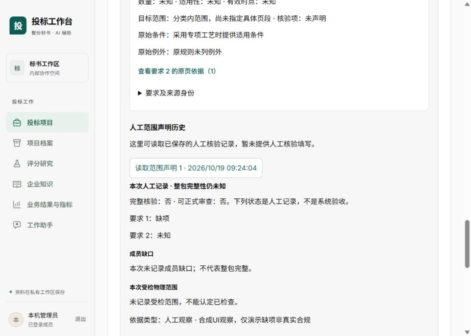

# 要求清单工作面验证

日期：2026-10-19。应用提交：`8be7386`，分支`fusion/bid-workbench`。本片无新增DDL、库权限或运行依赖。

## 实现范围

本方包明确修订的详情新增“要求清单与覆盖”，按需展开，分别读取当前／历史清单和对应人工范围声明。权威包及明确修订由真实目录发现，原规则集使用现有规则接口的确切顶层ID；不自动选最新解析、规则或依据修订，不把当前规则重拼成历史。

唯一新增写交互为创建未映射清单，固定`mappings:[]`。原规则全文、条件、例外、决定及依据保留，分类／数量／适用性／时点保持未知。已有清单时明确提示追加全未映射新修订、不沿用旧检查计划或覆盖。人工检查计划填写、证据选择及覆盖声明写入尚待下一片。

创建前将完整成员／项目／包修订／摘要、正文、幂等键及首版／后续版本条件写入会话存储；失败不能持久化则零发送。未知结果刷新后使用原请求恢复，不允许换正文／新键。已未知操作遇通用前置422／428／409不据此抹除原记录；仅明确后置业务／版本拒绝可解除。项目关闭后仍允许核对原键旧ACK，新建禁用。旧范围迟到结果不进入新工作面，损坏本地记录锁定新增。

## 验证

- 执行者组件19项通过；主代理独立专项37项通过，包含该19项、既有资料包13项及API 5项。主代理完整前端 **199项／40文件通过，12.92秒**。计数有包含关系，不相加。
- 全前端格式、ESLint、TypeScript及生产构建通过；构建2.07秒，主入口`index-Cw-9D1kT.js`。已有助手静态／动态混用的Vite分包提示保留，不伪报为无提示构建。
- 内置浏览器真实访问同Compose预览5188：登录态进入项目资料→明确本方包→展开要求面→明确依据包及修订→创建首版→追加第二版→刷新→独立回看旧版及当前版→读取当前版人工观察历史。原首版完整manifest及规范摘要保持不变。
- 1440×900及390×844实看条款全文／条件／未知状态／历史按钮，未横溢。DOM读数分别clientWidth=scrollWidth=1425、375（浏览器滚动条占15px）；临时viewport已reset。该检查不等于全字号、200%缩放或全部模块验收。
- 浏览器当前版观察显示“要求1缺项、要求2未知”“完整核验否、可正式审查否”；受检范围空时明确不能认定已检查，没有绿色通过或正向核验写按钮。

合成项目`c44f94b5-6491-4cb5-9e39-063cfa874394`中，首版清单`bd6a5c77-c1b0-41b8-89ba-2cee6919a9c1`摘要`59cbfc416fa99f1cc7f614fff59d4a12fcb426da55f7a27f7924be69df97057f`；第二版`4f6aa551-5c8b-4bf5-ba1d-462fb31744db`摘要`9e70498a399047160efdbff281abafa776989486fdf9abebad3f104532cd86e3`。完整规范输入与独立重算结果见原始证据。

## 合成夹具与边界

验证仅在固定`tender-fusion`组既有API服务中使用独立预览v2的非owner API账号。没有新建临时容器、使用owner修业务权限、启动旧dev／Claude容器或真实供应商请求。正常预览三个服务保留健康，checks保持停止。

项目／文件名／条款均标合成。两份文件、已核上传、解析和证据是明确合成元数据，未上传真实PDF，未执行OCR、原件存储或模型；不作为真实质量通过。原入库面板计数和未配置的Word协议不属于本片验收。首轮夹具漏必填heading_path在创建包422后停止；只续建既有合成项目，不重跑或清库。规则夹具缺范围导致真实GET422，保留旧规则，追加带完整范围及人工来源的新规则包后真实GET与完整schema验证通过，旧行摘要不变。没有为夹具放松业务协议。

覆盖历史通过既有正式API追加**一条合成负向人工观察**（missing、空受检范围、无证据、合成理由），另一条无结果保持unknown；不是通过新页面填写，不修改映射、不产生positive结论。追加前后首版完整规范bytes与摘要相同，观察自身规范摘要与响应schema也验证通过。旧规则的完整抽取解析身份仍未冻结，`inventory_complete=false`、`review_ready=false`保持；本片不接正式整包评审／评分／提交。

失ACK／前置错误／关闭后旧ACK／分页等专项使用组件合成HTTP，未做浏览器断网注入；原页下载／完整证据选择／成员缺口非空矩阵、真实解析／上传与完整业务阶段门仍待后续。主代理和独立产品只读审查已核对失ACK修复及上述资格边界。

## 真实截图与原始记录

[原始证据](evidence/)包含199项与37项XML、完整两版manifest及观察、合成准备公开回执和启动源码／dist／镜像摘要。启动指纹是开发挂载的时点记录，不冒充不可变镜像发布。
