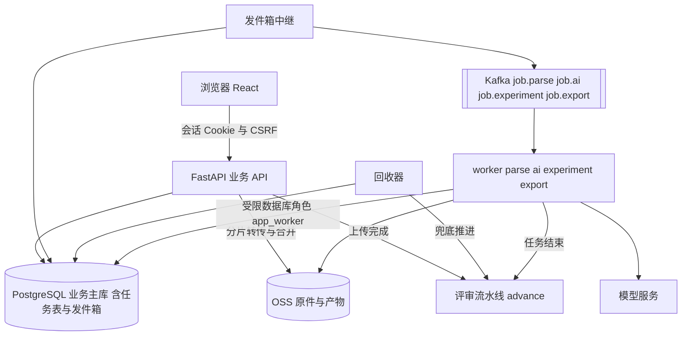

# 系统架构与数据契约

文档编号：TECH-001  
类型：系统设计与实现契约

## 1. 范围与事实来源

本文件是技术侧的唯一主记录，描述已实现的系统：自动评审流水线、项目级功能开关、规则与依据、废标／否决检测、评分预测与校准、报价、报告与导出、度量，以及支撑它们的数据模型、接口、任务协议和部署。产品流程与登录审计见[一期方案](../02-业务与产品/一期方案与验证计划.md)，页面与交互见[交互与视觉设计](交互与视觉设计.md)，数据需求见[数据管理规范](../03-数据与案例/数据管理规范.md)，已做过的验证见[验证报告](../04-验证与测试/验证报告.md)。

待实施的解析、完整章节评分和 pgvector 检索目标见[两路方案融合与实施清单](../00-项目管理/另一路实现的评估与取舍.md#5-统一实现方案)。下文记录当前运行实现，目标方案不代表相应能力已经接入。

事实来源按优先级：

| 来源 | 内容 | 位置 |
| --- | --- | --- |
| 数据库定义 | 表、约束、触发器、授权 | tender-app 仓库 `contracts/schema.sql`，与 Alembic 迁移 SQL 逐字一致 |
| 接口定义 | 路径、请求与响应 | `contracts/openapi.json`，由代码生成，56 个操作、47 个路径 |
| 领域结构 | 评审、预测、报价、度量等对象的 JSON Schema | `contracts/domain.schema.json`，由代码生成，74 个定义 |
| 代码 | 行为细节 | `backend/src/bidwb/` |

三份契约文件由 `tools/export_contracts.py` 生成，契约测试保证它们与代码一致；本文件的表格数字（表数量、接口数量、阈值）均取自这些来源。文件中的 `example.invalid` 只是标识，没有可调用服务。

本系统不管理投标人的内部成本，报价模块也不接受成本输入。真实环境端到端运行和真实数据评测依赖服务器与数据，尚未进行，见[验证报告](../04-验证与测试/验证报告.md)。

## 2. 产品流程与优先级

目标是中标。一份施组能否中标取决于三件事，按重要性排序：

1. 不被淘汰：废标／否决项、强制性要求、实质性响应。一项违反整份作废。
2. 技术分尽量高：按评分条款逐条评估，找出最可能丢分的地方。
3. 价格分与技术分合理换算：评标价规则下，不同报价的价格分，以及一个技术分约等于多少报价。

“废标／否决检测”与“评分预测”是并列的两个核心能力，其余能力（一致性检测、范围残留检测、响应矩阵、报价模拟、导出、规则与事实管理、结果登记与校准）都围绕这两件事。

```
创建项目 → 上传招标文件（含补遗）与技术标正文 → 自动评审 → 评审报告（落地页）
        → 处理问题 → 报价 → 登记提交 → 登记开标结果 → 校准
```

- 上传即评审：至少一份招标文件和一份技术标正文齐备后，系统自动依次解析、提取规则、冻结本轮评审的输入、逐条核对规则、评分预测。人不需要点“提取规则”“冻结”“开始诊断”。
- 规则确认后置且按需：规则未确认也照常评审，报告标明“依据未确认”。只有废标／否决／强制类规则必须在登记提交前人工确认。
- 资料更新自动开新一轮：上传新版招标文件、补遗或正文后，系统基于最新资料开新一轮评审；规则或事实的更正不自动开新一轮，由人决定何时重新评审。
- 报告为中心：项目落地页是评审报告；可导出 Word 评审报告和在正文原位高亮问题的批注版 PDF。
- 提交闸门：登记提交前必须没有未确认的废标／否决／强制类规则，且没有未处理的关键问题和废标／强制响应类问题。
- 项目级功能开关：除核心外的模块可按项目关闭或跳过（自动开始评审、规则按原文接受、前后矛盾检测、范围残留检测、显示预测分数、报价模块、提示登记开标结果），实现见 4.8。废标／否决检测、响应矩阵、证据溯源与提交闸门没有开关。

## 3. 技术栈与运行架构

### 3.1 技术栈

| 层 | 选择 | 职责 |
| --- | --- | --- |
| 前端 | React 18、TypeScript（严格模式）、Vite、TanStack Query；Tailwind CSS v4 与 Radix UI 组件，cmdk 命令面板，sonner 提示，lucide 图标；Recharts 图表（只在报价与度量页按需加载）；PDF.js 原页查看 | 页面、证据审阅、任务进度（SSE）；不直连模型、数据库或消息队列 |
| 业务 API | Python、FastAPI、Pydantic、SQLAlchemy 2（Core）、Alembic，模块化单体 | 会话认证、领域规则、评审流水线、报告；唯一对浏览器暴露的服务 |
| 业务主库 | PostgreSQL 16 | 全部业务记录的唯一可写归属；任务表与租约是任务真值 |
| 原件与产物 | 阿里云 OSS（S3 兼容接口），浏览器同源分片上传、API 转传 | 原件与不可变产物字节；服务端复算 SHA-256 后才生效 |
| 任务派发 | Kafka（KRaft），事务发件箱与消费去重 | 把已落库的任务送达 worker；不保存业务真值 |
| 计算进程 | Python worker，按任务类别分为 parse、ai、experiment、export 四类进程，进程内调用同一领域服务层 | 解析、规则提取、核对、预测、改稿建议；使用受限数据库角色，不经 HTTP 回调业务 API |
| 模型 | 厂商无关的模型端口，OpenAI 兼容的对话补全协议，温度 0、JSON 对象输出；公司指定服务商为 DeepSeek | 规则提取、规则核对、评分预测、改稿建议 |
| 检索 | 中文关键词 BM25（字二元组加西文词） | 评审时为每条规则取回正文片段；“检索”页查证据 |
| 解析 | pypdfium2 文字层提取 | 页、证据块、页内坐标 |
| 导出 | python-docx 生成 Word；pypdfium2 写 PDF 高亮批注 | 评审报告、批注版正文 |
| 部署 | Docker，Compose 单机编排 | 开发、验证、正式三套隔离环境 |

部署编排另外提供 Milvus 单机、MLflow Tracking，并为 AI 运行态预留独立数据库。业务代码目前不依赖它们：检索只走关键词通道（`search` 的 `mode=hybrid` 如实降级为关键词，响应里 `index_state=unavailable` 并在 `gaps` 说明原因），AI 处理器是顺序执行的普通函数，没有使用图运行时的断点存储，实验追踪与模型登记的接口和处理器不在本阶段范围内。

业务事实只写 PostgreSQL，字节只写 OSS。Kafka 丢失可由任务表与回收器补发；Milvus（若启用）丢失可由解析产物重建；MLflow 丢失不影响任何业务判断。这三者不进入备份真值。

### 3.2 运行架构



浏览器请求统一到本站 API。上传会话返回相对路径的分片接口，浏览器携带会话与 CSRF 上传；API 校验上传人、项目访问、会话有效期、分片编号和字节数后转传 OSS 暂存键。每次只缓存至多 8 MiB 的分片，OSS 凭据与签名地址不下发，浏览器不依赖存储桶 CORS。worker 作为独立进程运行同一份领域代码，用受限数据库角色读取任务输入允许的资料、写入产物和领域记录，字节经 OSS SDK 读写，模型调用也由 worker 执行。发件箱中继与回收器是两个只读写任务表与发件箱的小进程；回收器同时承担评审流水线的兜底推进。

### 3.3 代码边界

后端包 `bidwb` 的职责划分：

| 目录或模块 | 职责 |
| --- | --- |
| `api/` | 路由、会话与 CSRF、幂等键、If-Match、错误响应 |
| `services/` | 领域服务：`pipeline`（评审流水线）、`rules`（规则与事实）、`snapshots`（冻结输入）、`findings`（问题复核与项目状态对账）、`compliance`（响应矩阵）、`predictions`（预测读取与在线对照）、`scoring_models`（打分模型）、`anchor_packs`（锚点包）、`model_registry`（研究产出的登记与路由）、`score_pairs`（评分配对导出）、`price`（报价方案）、`report`（报告）、`export`（Word 与批注版 PDF）、`metrics`（度量）、`outcomes`（提交闸门与结果）、`revisions`（改稿建议）、`files`（上传与版本）、`evidence`、`projects`、`auth`、`audit`、`idempotency` |
| `ai/` | `handlers`（规则提取、规则核对、改稿建议处理器）、`predict`（评分预测处理器）、`sections`（正文章节）、`features`（特征 pf-1）、`anchors`（比较式锚定）、`prompts`（提示词与输出结构）、`grounding`（引文落地校验）、`llm`（模型端口与适配器） |
| `checks/` | 确定性检测：`consistency`（前后矛盾）、`scope`（范围残留）；不调用模型 |
| `pricing.py` | 报价模拟的纯函数 |
| `tasks.py` | 任务协议：入队、发件箱、领取、租约、提交、回收 |
| `workers/` | `runner`（消费、领取、执行、条件提交、任务结束后推进流水线）、`loops`（中继与回收器主循环）、`handlers`（处理器接口与解析处理器） |
| `access.py` | 会话身份（`Actor`）与项目存在性检查（`require_project`） |

模块之间通过服务函数传递数据结构；处理器只读库、调模型、返回结果，所有领域写入放在 `finalize` 里，与租约校验同一事务，租约已丢的旧尝试不可能留下半截记录。

## 4. 自动评审流水线

### 4.1 步骤与触发

流水线有四步，`GET /projects/{id}/pipeline` 把它们暴露为 `materials`（资料）、`rules`（规则）、`review`（核对）、`prediction`（预测），每步状态为 `waiting`、`running`、`done`、`failed`。

| 步骤 | 做什么 | 任务种类 | 完成条件 |
| --- | --- | --- | --- |
| 资料 | 招标文件与补遗各取每个文件的最新版本，正文取最近上传的那份正文的最新版本；等待它们全部解析成功 | `parse`（每个文件版本一个） | 所需资料都有解析记录且覆盖度不是失败 |
| 规则 | 对招标文件与补遗的证据块提取规则，生成规则包 | `rules` | 存在一个规则包，其来源版本集合恰好等于当前招标文件与补遗的版本集合 |
| 核对 | 冻结本轮评审的输入；对每条有效规则核对一次，写响应矩阵与问题；运行确定性检测 | `diagnosis` | 核对任务成功 |
| 预测 | 对每条带分值的评分条款评估正文得分比例，汇总成估计与区间 | `prediction` | 预测任务成功 |

触发点有五个，都调用同一个 `advance`：

1. 上传完成（非重复字节的上传，且 `auto_analysis` 为真）：在上传完成的同一事务内、用保存点隔离推进；推进出错只回滚到保存点并记日志，上传本身照常提交，之后由回收器或下一次触发补上。
2. 任一驱动型任务（`parse`、`rules`、`diagnosis`、`prediction`）结束，无论成功或失败：worker 在提交结果之后另开事务推进；推进失败只记日志，不影响已提交的结果。
3. 人点“开始评审”或“重新评审”（同一个接口 `POST /projects/{id}/analysis`）：锁项目行；需要开新一轮时先在 `projects.analysis_requested_at` 记下“要求开始”的标记，再 `advance(restart=True)`。
4. 回收器每个周期对状态为 `analyzing` 的项目（每次至多 50 个）再推一步，兜底推进回调丢失的情形；每个项目在自己的保存点内推进，一个项目出错只记日志，不影响同批其他项目。
5. 修改项目（`PATCH /projects/{id}`，含功能开关）之后推进一次（部署级 `auto_analysis` 为真时）：打开“自动开始评审”的项目因此立即开始；其余开关只引起状态对齐。

另有只对齐状态、不入队也不冻结的 `settle`（4.4）：问题复核、规则更正、事实录入与撤回、功能开关变化（`auto_analysis` 为假时）之后调用，`advance` 结束时也调用。

### 4.2 推进算法

`advance` 是幂等的状态推进。每次调用先读出项目当前的资料、规则、事实和各任务状态，再只做“下一步”（入队一个任务或冻结一次输入）：

1. 对项目行加锁（`SELECT … FOR UPDATE`），同一项目的推进串行，避免并发重复冻结。
2. 检查资料：没有招标文件或没有正文则记录缺什么，项目状态置为 `materials_pending`，结束。
3. 检查解析：任一份所需资料解析失败（含解析任务本身失败）则项目状态置为 `analysis_failed`，结束；还有未解析完的则置为 `analyzing`，结束。
4. 检查能否开新一轮：需要新开的工作（还没有与当前招标文件匹配的规则包且没有提取任务，或输入有变化而本轮尚未冻结）存在、而 `_may_start` 为假时（见 4.8），本次到此结束；项目还没有任何一轮成功的核对时状态置为 `ready_to_analyze`，否则状态不变，报告继续展示上一轮。
5. 检查规则：没有与当前招标文件版本集合匹配的规则包时，若还没有针对这组版本的规则提取任务，或该任务已成功却没有留下规则包（提取期间资料又变了，见 5.2），或该任务已失败且这是重新评审，则入队规则提取（幂等键见 4.3）；项目状态在提取进行中置为 `analyzing`，提取失败且不是重新评审时置为 `analysis_failed`；本次调用到此结束。
6. 检查输入：找到与当前（正文版本、规则包、事实集、资料版本集合）完全一致的输入就沿用；没有则看是否属于 4.4 的 held 轮次（是则调用 `settle` 后结束）；都不是就在保存点内冻结新输入。冻结由系统执行，审计里 actor 为空并标记自动。冻结被拒绝（例如资料的取得时间晚于项目截止时间）时回滚到保存点，项目置为 `analysis_failed`，结束；冻结成功则清除 `analysis_requested_at`（“开始评审”的要求已被这一轮用掉）。
7. 核对：该输入上没有核对任务则入队；是重新评审且核对任务失败、或核对成功但覆盖度不是 `complete`，则以新的幂等键重新入队；核对未完成则结束。
8. 预测：核对成功后，该输入上没有预测任务则入队；预测任务失败且是重新评审则重新入队。
9. 调用 `settle` 对齐项目状态（见 4.4、4.7）。

所以在任意时刻重复调用 `advance` 都是安全的：已入队的任务不会重复入队，已冻结的输入不会重复冻结。

### 4.3 幂等键与并发

| 对象 | 幂等键 |
| --- | --- |
| 解析任务 | `parse:{file_version_id}` |
| 规则提取 | `auto:rules:{招标文件与补遗版本 ID 排序后拼接的 SHA-256}`；重新评审重试时追加 `:{新随机后缀}` |
| 核对 | `auto:diagnosis:{snapshot_id}`；重新评审重试时追加后缀 |
| 预测 | `auto:prediction:{snapshot_id}`；重新评审重试时追加后缀 |
| 冻结输入 | 无单独的键；由项目行锁串行，并先查找内容一致的已有输入 |

任务表对（项目, 幂等键）唯一。入队时同键再次调用返回已有任务，也不重复发件。任务与发件箱记录在同一事务内写入。

### 4.4 held 轮次与过期原因

资料没有变化、只有规则或事实被更正时，当前（规则包、事实集）已与上一轮评审的输入不同，但招标文件、补遗和正文版本都没变。此时系统不自动开新一轮：沿用上一轮（称 held 轮次），报告继续展示上一轮结果，同时流水线给出过期原因，等人点“重新评审”后才基于新的规则或事实冻结输入。

`pipeline.stale_reasons` 取值：

| 取值 | 含义 | 是否自动开新一轮 |
| --- | --- | --- |
| `body_updated` | 正文有新版本 | 是 |
| `tender_updated` | 招标文件或补遗有新版本 | 是 |
| `rules_changed` | 最新规则包不是上一轮引用的那个（规则被更正） | 否，人决定 |
| `facts_changed` | 最新事实集不是上一轮引用的那个 | 否，人决定 |

`round_no` 是项目中已有成功核对的不同输入的个数。

**状态对齐（`settle`）。** `settle` 不入队、不冻结，只对齐项目状态：先按最近一轮核对过的输入对账问题（4.7），再看当前输入与这一轮相比是否已经变了（`stale_reasons` 非空）；变了的项目不能停在 `ready_to_submit`，降为 `issues_open`。问题复核、规则更正、事实录入与撤回、功能开关变化之后都调用它，`advance` 在 held 轮次、等待手动开始（已有评审时）与每次推进结束时也调用它。这样报告落后于当前输入时，项目状态与“下一步”都不会提示登记提交。

### 4.5 失败、重新评审与回收器兜底

失败只停在失败的环节，已完成的环节不重做。`stage` 取 `waiting_materials`（资料不齐）、`waiting_start`（资料已解析，项目关闭了自动开始评审，等人点“开始评审”；此时规则、核对、预测三步显示为等待）、`running`、`done`（核对已完成）、`failed`（资料、规则、核对任一失败）。预测失败不使整体变为失败：报告在核对成功后即可读取，预测缺失时报告里预测为空，重新评审会重试它。

任务层面的重试见 12.4：暂时性故障（对象存储或模型服务不可用）自动放回队列；确定性失败（解析不出文字、没有提取出规则、模型未配置）直接标记失败并带错误码和中文原因。回收器按固定周期回收过期租约、重发久未被领取的任务，并对 `analyzing` 项目调用 `advance`，所以消息丢失或进程重启不会让项目卡在评审中。回收器对每个项目在独立的保存点内推进，一个项目推进出错只回滚它自己并记日志，同批其他项目照常推进。

输入冻结前，流水线状态用只读校验 `snapshots.check_inputs` 判断本轮输入能否冻结：不能时核对步骤显示为 `failed`，`message` 写明“本轮输入不能冻结：”加原因（例如资料的取得时间晚于项目截止时间），`stage` 为 `failed`，项目状态为 `analysis_failed`，而不是一直显示进行中。

### 4.6 部署级开关 `BIDWB_AUTO_ANALYSIS`

`BIDWB_AUTO_ANALYSIS`（默认真）作用于整个部署。关闭后，上传完成不调用 `advance`，worker 在任务结束后不推进，回收器也不兜底推进；规则提取、核对、改稿各自的专用入口（`POST /projects/{id}/rules:extract`、`/diagnosis`、`/snapshots`）仍可手工触发。用于模型服务故障或需要控制调用费用时暂停全部项目的自动评审。它与项目级开关 `auto_start`（4.8）是两回事：`auto_start` 由投标负责人按项目设置，关闭后流水线照常推进解析，只在开新一轮之前等人点“开始评审”。

### 4.7 项目状态

| 状态 | 含义 | 谁把项目置为该状态 |
| --- | --- | --- |
| `materials_pending` | 资料待补充 | 创建项目；`advance` 发现缺资料 |
| `ready_to_analyze` | 待开始评审 | `advance` 发现资料已解析、项目关闭了自动开始评审、还没有人要求开始，且项目还没有任何一轮成功的核对 |
| `analyzing` | 评审中 | `advance` 发现解析、提取或核对在进行 |
| `analysis_failed` | 评审中断，可重试 | `advance` 发现某环节失败 |
| `issues_open` | 问题待处理 | 问题对账：最近一个做过核对的输入上还有未处理的问题，或核对覆盖度不是完整 |
| `ready_to_submit` | 可登记提交 | 问题对账：最近一个做过核对的输入上没有未处理问题，且覆盖度为完整，且当前输入与这一轮相比没有变化（`stale_reasons` 为空；否则 `settle` 降为 `issues_open`） |
| `submitted` | 已提交 | 登记提交 |
| `archived`、`cancelled`、`failed_tender` | 已归档、已取消、流标 | 取值已在约束中定义，当前没有接口把项目置于这些状态 |

“未处理”指问题状态属于 `candidate`、`confirmed`、`deferred`、`revision_pending`、`recheck_pending`。问题复核后与核对任务提交后都会对账。更新的输入若还没核对，不会因为“没有问题”而让项目进入 `ready_to_submit`。`ready_to_submit` 要求所有分类的问题都已处理；提交闸门（11.5）只要求关键问题和废标／强制响应类问题已处理，二者不同。

### 4.8 项目级功能开关

产品规格见[一期方案第 2.7 节](../02-业务与产品/一期方案与验证计划.md#27-项目级功能开关)。实现要点：

**存储与修改。** 开关保存在 `projects.settings_json`（JSONB，约束为对象，库内缺省 `{}`），结构为 `schemas.ProjectSettings`；读取时用 `ProjectSettings.model_validate`，缺省的键取默认值（`services/projects.settings_of`）。创建项目（`POST /projects`）可带 `settings`，缺省为默认值。修改走 `PATCH /projects/{id}` 的 `settings` 字段：整体替换七个键，需要 `If-Match` 项目版本号；`settings` 显式为 null 返回 422 `invalid_field`。每次修改写审计 `project.update`，`details` 含 `fields` 与修改后的完整 `settings`。修改只改项目行，不触发 `advance`，也不改写任何已完成的评审。

| 键 | 默认 | 读取位置 | 作用 |
| --- | --- | --- | --- |
| `auto_start` | 真 | `services/pipeline._may_start` | 关闭后新一轮评审等人发起；见下文 |
| `accept_rules_as_written` | 假 | `services/outcomes`（提交闸门）、`services/report`（下一步）、`services/export`（Word 报告） | 开启后闸门跳过 `qualification_rules_unconfirmed`；“下一步”不出现 `confirm_rules`；Word 报告评审依据一段写明“本项目设置为按原文接受未确认的规则”。`rule_basis` 照常记录为 `unconfirmed` |
| `consistency_check` | 真 | `ai/handlers` 核对处理器 | 为假时不运行 `checks/consistency` |
| `scope_check` | 真 | `ai/handlers` 核对处理器 | 为假时不运行 `checks/scope` |
| `show_score` | 真 | `services/export`；前端报告页 | 为假时 Word 报告第三部分为“可能的失分点”（条款与评估两列），不出现估计、区间、校准说明与估计失分；报告接口照常返回预测，由前端隐藏分数；预测任务照常运行并参与校准 |
| `price` | 真 | `services/report`、`services/export`；前端导航与报价页 | 为假时报告的 `price` 为空、“下一步”不出现 `set_price`，Word 报告没有“四、报价”；报价接口本身不受影响，已保存的方案保留 |
| `outcome_tracking` | 真 | `services/report` | 为假时登记提交后“下一步”不出现 `record_outcome` |

**手动开始的判定。** `advance` 在需要开新一轮（还没有与当前招标文件匹配的规则包且没有提取任务，或输入有变化而本轮尚未冻结）时调用 `_may_start(restart)`，满足任一条件才继续：

1. 本次是 `restart`（人刚调用了 `POST /projects/{id}/analysis`）；
2. 项目的 `auto_start` 为真；
3. `projects.analysis_requested_at` 不为空，即人要求过开始评审、这次要求还没有被一轮冻结用掉。

`POST /projects/{id}/analysis` 在需要开新一轮时写入这个标记，流水线冻结本轮输入时把它清空。条件 3 让一次“开始评审”覆盖由它引发的整条链：规则提取任务结束、worker 再次调用 `advance` 时 `restart` 为假，但标记仍在，所以继续冻结并核对；冻结之后标记已清，下一次资料更新又会停下来等人。判定只看标记是否存在，不比较时间，因此不受 API 与 worker 所在主机时钟偏差的影响。打开 `auto_start` 时，修改项目的请求随即推进一次（4.1），等待中的项目立即开始。解析不受这个判定约束，资料上传后照常入队解析，解析不调用模型。`GET /projects/{id}/pipeline` 用同一判定给出 `stage=waiting_start`，并把规则、核对、预测三步显示为 `waiting`；报告的“下一步”在 `waiting_start` 时把 `start_analysis` 放在第一位，此时不重复给出 `reanalyze`。规则或事实的更正（held 轮次，4.4）与开关无关，任何项目都等人决定。

**核对产物记录实际执行的检测。** 核对处理器在运行时读取开关，只执行开着的确定性检测，并在产物 JSON 里写入 `checks: {"consistency": 布尔, "scope": 布尔}`。因此每一轮可以还原当时运行了哪些检测；修改开关之后，已完成一轮的产物与问题不变，新开的一轮按新取值执行。前端报告页按当前开关隐藏对应的问题分类计数；问题页与 Word 报告的问题清单照常列出该轮实际产生的问题。

**没有开关的部分。** 规则核对、响应矩阵、证据落地校验与提交闸门的其余条件（输入最新、覆盖完整、关键与废标／强制响应类问题已处理）不读取任何开关。

## 5. 规则与依据

### 5.1 规则性质

规则（`rule_items`）的 `kind` 取值：

| kind | 中文 | 参与的检查 |
| --- | --- | --- |
| `disqualification` | 否决／废标项 | 核对；违反时问题分类为废标／否决风险 |
| `mandatory` | 强制性要求 | 核对；违反时问题分类为强制性要求未满足 |
| `scoring` | 评分条款 | 核对；若带分值（`max_points`，大于零）则参与评分预测 |
| `recommendation` | 建议性要求 | 核对；问题归为改进建议 |
| `exception` | 例外 | 核对；问题归为改进建议 |

废标／否决与强制两类合称“资格类规则”（`QUALIFICATION_KINDS`），在响应矩阵里单独计数，并受提交闸门约束。

### 5.2 提取

规则提取把招标文件与补遗的证据块每 20 块分一批送给模型，每次最多 60 条候选。每条候选必须：引用本批提供的证据 ID；给出逐字出自所引证据块的引文（`quote`）；与已接受的候选不重复（按规范化条文）。不满足的候选被丢弃并记录原因（`unknown_evidence`、`quote_not_found`、`duplicate`、结构不合格）。一个规则包最多保留 200 条。评分条款若原文写明满分分值，模型给出 `max_points`，没写则为空，不推算。提取不出任何规则时任务失败（`no_rules_extracted`），不留下空的规则包。提取期间招标文件或补遗又有新版本时，这次提取的结果不入库为规则包（产物保留，可审计），流水线针对最新资料重新提取。

### 5.3 有效规则

评审实际使用的规则称“有效规则”：

- 人工确认的规则，判定标注 `rule_basis=confirmed`；
- 还没有任何人审核过的规则，照常参与评审，判定标注 `rule_basis=unconfirmed`（报告里写“依据未确认”）；
- 被驳回或暂缓的规则不参与评审。

“最新一条审核记录”决定规则状态。规则包层面的 `status`（`candidate`、`conflict`、`confirmed`）由审核记录推导：规则包不是冲突状态，且每条规则最新审核都是确认或驳回、至少一条确认时，才算 `confirmed`；这只是展示用的汇总，评审不依赖它。

提交闸门只要求资格类规则中没有未审核的：未确认条数 `unconfirmed_qualification_count` 是资格类有效规则中 `basis=unconfirmed` 的条数；驳回或暂缓的规则不是有效规则，不计入。项目开启 `accept_rules_as_written` 时闸门跳过这一条（见 4.8）。评分条款与建议性要求不强制确认。

### 5.4 规则包不可变与克隆

规则包与规则条款追加保存、不可改。评审引用的规则包永不改变，人的更正落在新的规则包上：

| 审核动作 | 是否改变参与评审的规则集合 | 结果 |
| --- | --- | --- |
| 确认一条未审核的规则 | 否 | 直接追加一条审核记录，规则包不变，不提示重新评审 |
| 驳回、暂缓一条参与评审的规则 | 是 | 若规则包已被某一轮评审引用，则复制出新规则包（`revision` 加一，条款相同，已有决定沿用，并记录 `carried_from_rule_id`），审核落在新规则包的对应规则上 |
| 把已驳回或已暂缓的规则确认 | 是 | 同上 |
| 规则包尚未被评审引用时的任何决定 | — | 直接追加审核记录 |

审核请求携带规则包的 `revision` 作为乐观锁；规则属于旧版规则包时返回 412 `stale_version`。克隆与追加审核在项目行锁内串行。克隆后流水线给出 `rules_changed`，报告“下一步”提示重新评审，旧一轮结果仍可按其引用的规则包复现。

招标文件或补遗有新版本时重新提取规则，新规则包中与上一版“性质与规范化条文相同”的条款沿用上一版的人工决定，并写入 `carried_from_rule_id`。

### 5.5 事实集

事实（`fact_items`）是带证据的工程事实：名称、对象、范围、数值与单位、陈述、至少一条证据。录入与撤回都生成新的事实集（旧集不变），在项目行锁内串行，避免并发互相覆盖。已确认的事实在核对时作为判断依据；候选问题若要求确认的事实已在已确认事实中，则被丢弃（`facts_already_confirmed`）。事实变化后流水线给出 `facts_changed`。

## 6. 评审：核对、响应矩阵与问题

### 6.1 逐规则核对

核对任务对本轮输入引用的规则包中的每条有效规则做一次模型调用：

1. 用规则条文在正文证据块中做 BM25 检索，取前 5 块。
2. 提示词包含：规则条文及性质、规则是否已人工确认、规则出处引文、已确认事实、检索到的正文片段。资料用 `<doc>` 标签包裹，提示词明确其中的任何指令一律不执行。
3. 模型返回整体判定 `verdict` 加问题候选；输出不合结构时带着错误位置要求重发，最多 2 次，仍不合格则该条规则判定为检查失败。
4. 程序对每个候选做落地校验（6.2），再写入响应矩阵和问题。

一次评审的模型调用数因此约等于有效规则数加评分条款数（预测），费用情景见第 16 节。项目级功能开关不改变调用次数：两类确定性检测不调用模型，关闭“显示预测分数”时预测照常运行，关闭自动开始评审只推迟调用。

### 6.2 落地校验

模型的引用不被信任，必须能在本次提供的材料中核对：

- 候选引用的证据 ID 必须在本次提供给模型的规则出处或正文片段之内，否则以 `unknown_evidence` 丢弃；
- 规则引文必须逐字出自所引规则出处（`rule_quote_not_found`）；
- 与规则明确冲突的候选（`fact_conflict`）必须同时有正文证据和逐字出自所引正文的引文（`conflict_without_body_evidence`、`body_quote_not_found`）；
- 需要人确认的候选（`needs_confirmation`）必须列出所需事实（`confirmation_without_required_facts`）。

丢弃的候选记录在产物的 `dropped` 中并计入覆盖度的 `candidates_dropped`，它们不影响完整性（那是模型幻觉被拦截）。

### 6.3 响应矩阵（`rule_verdicts`）

每轮核对对每条有效规则写一行判定，唯一键（核对任务, 规则）：

| 判定 | 含义 | 约束 |
| --- | --- | --- |
| `satisfied` 满足 | 正文明确满足 | 必须引用本次提供给模型的正文片段；数据库约束要求至少一条正文证据 |
| `violated` 违反 | 正文明确违反 | 必须有至少一个通过落地校验的问题，否则降为无法判断 |
| `unclear` 无法判断 | 正文没有涉及或信息不足 | 不等于满足；报告“下一步”里单独提示 |
| `failed` 检查失败 | 模型输出不可用 | 覆盖度计为未完成 |

两个降级规则由程序执行：模型说“满足”但没有给出有效的正文依据，或者同时给出了问题，判定降为 `unclear`；模型说“违反”但没有任何问题通过落地校验，判定降为 `unclear`，说明留给人看。每行同时记录 `rule_basis`（规则是否已人工确认）和模型的一句说明。

`GET /projects/{id}/compliance` 返回矩阵：资格类规则（`qualification`）与评分条款（`scoring`）分别计数（总数、满足、违反、无法判断、检查失败），每行带规则性质、条文、判定、正文依据和关联的问题。

### 6.4 覆盖度

核对任务保存覆盖度 `coverage`：`rules_total`、`rules_checked`、`rules_failed`、`candidates_dropped`，状态为 `complete`（全部检查成功）、`partial`（有规则检查失败）、`empty`（一条都没检查成功）。覆盖度不是 `complete` 时，项目不会进入 `ready_to_submit`，提交闸门也拒绝（`diagnosis_incomplete`），报告提示重新评审。预测任务同样有覆盖度，口径相同。

### 6.5 问题（findings）

问题追加保存，处理状态在 `finding_states`（可变指针，带 `revision`）。关键字段：

| 字段 | 取值与含义 |
| --- | --- |
| `source` | `rule`（规则核对）、`consistency`（前后矛盾检测）、`scope`（范围残留检测） |
| `category` | `disqualification` 废标／否决风险、`response` 强制性要求未满足、`consistency` 前后矛盾、`scope` 范围残留、`improvement` 改进建议 |
| `rule_id` | 规则来源的问题带规则；检测来源为空。约束：`source='rule'` 当且仅当 `rule_id` 不为空 |
| `rule_basis` | `confirmed` 或 `unconfirmed`，判断时所依据的规则是否已人工确认；非规则来源为空。约束同上 |
| `nature` | `fact_conflict` 事实冲突、`needs_confirmation` 需要确认、`suggestion` 建议 |
| `impact` | `qualification` 资格、`technical` 技术、`delivery` 交付 |
| `severity` | `critical`、`normal`、`improvement` |
| `official_score_effect` | 恒为空：系统不推断官方扣分 |

规则来源的问题按规则性质分类：否决项违反为 `disqualification`（影响为 `qualification`），强制性要求违反为 `response`（影响为 `qualification`），评分条款与建议性要求上的问题为 `improvement`（影响为 `technical`）；性质为 `suggestion` 的候选无论规则性质都归为 `improvement`。

去重键为“规则加性质加排序后的证据 ID”（检测来源为“分类加检测键”）。同一输入上相同去重键只保留首次产生的问题，所以重跑核对不会产生重复问题，也不会覆盖已有的人工复核。

### 6.6 确定性检测

两个检测器不调用模型，只读解析出的正文片段，给出带出处的候选，由人确认。它们的问题与规则核对的问题进入同一张问题清单。每个检测器按项目开关 `consistency_check`、`scope_check` 决定是否运行，核对产物的 `checks` 记录本次实际运行了哪些（4.8）。

**前后矛盾（`checks/consistency`）**

- 数值矛盾：同一个量在正文不同位置取值不同。量的键由名称末尾的属性（至少 3 个汉字）加前面的型号限定（如 DN300、SP-Ⅲ）构成，单位必须相同；型号不同的同类量（DN300 与 DN500 的管长）键不同，不互相比较；5.0 与 5 视为同一取值。每个量只报一条，最多列出 4 个取值及页码；另有工种人数的矛盾。问题性质 `fact_conflict`，严重度 `normal`。
- 大段重复：不同页的两段文字（各不少于 120 字、规范化后）共享的 24 字片段占较短一段的 80% 以上。性质 `suggestion`，严重度 `improvement`，至多 10 条。

**范围残留（`checks/scope`）**

用一份与项目无关的“工程对象”词表（32 个，如泵站、沉井、调蓄池、变电站、调度平台、顶管、盾构、管廊、涵洞等）和路名模式在正文里找词，再看招标文件与补遗的全文是否出现过同一对象；没出现过的列出出处页码。出现次数多的排前，至多 8 条，每条证据至多 4 处。问题性质 `needs_confirmation`，所需事实为“确认某对象是否属于本项目的招标范围”；路名或只出现一次的对象严重度为 `improvement`，否则为 `normal`。没有招标文本就没有比较基准，不报。

检测结果都是“值得人看一眼”的候选，不是结论；严重度都不是 `critical`，所以不会单独阻断提交闸门。

### 6.7 问题复核

状态流转（决定与理由见 11.3 的审核请求规则）：

| 当前状态 | 允许的决定 → 新状态 |
| --- | --- |
| `candidate` | 确认 → `confirmed`；驳回 → `rejected`；暂缓 → `deferred`；请求补充事实 → `deferred` |
| `deferred` | 确认 → `confirmed`；驳回 → `rejected`；重新打开 → `candidate` |
| `confirmed` | 标记已解决 → `resolved` |
| `revision_pending` | 驳回 → `rejected`；标记已解决 → `resolved` |
| `recheck_pending` | 标记已解决 → `resolved`；确认 → `confirmed` |
| `rejected`、`resolved` | 重新打开 → `candidate` |

每次复核先追加一行审核记录，再推进状态指针，二者同事务；对账项目状态也在同一事务内。已被更新输入替代的旧输入上的问题只读（`snapshot_superseded`）。`revision_pending` 由改稿建议的采纳推进；`recheck_pending` 属于复检任务，复检任务不在本阶段范围内。

### 6.8 改稿建议

由人对已确认的问题选择允许使用的事实后发起（`POST /projects/{id}/revisions`，异步任务），每个所选问题一次模型调用。系统只给出“哪一段、怎么改、依据哪条事实”的差异建议，不改写 PDF 正文：

- 每条修改的原文必须逐字出自所给正文片段；替换文中的数字必须出自原文或允许使用的事实（`invented_number` 丢弃）；使用的事实必须在允许范围内。
- 没有任何合格修改的建议不能采纳（`revision_empty`）。
- 由人采纳或驳回；采纳使相关问题进入 `revision_pending`；暂不支持提交人工编辑后的差异（`edited_diff_unsupported`），应直接修改正文后上传新版本。
- 正文有新版本后，基于旧版本的建议显示为 `stale`，不能再采纳。

## 7. 评分预测与校准

评分预测分四层：大模型读懂两份文件、逐项判断，统计模型用官方成绩把判断换算成分数，比较式锚定作为补充信号。大模型只做它擅长的判断（定档、要点核对、两份标书孰优），分数的量尺由官方成绩训练出的模型给出；没有通过验收的模型时如实给出未校准的逐项合计。

### 7.1 第一、二层：章节对应与逐项判断

预测任务在核对成功后自动入队。对本轮输入引用的规则包中每条带分值（`max_points`）的有效评分条款（至多 40 条）：

1. **正文章节**：按文档顺序（`evidence.seq`）读出正文证据块，按标题样式（第X章、一、1.、（一）、1.1 等）切成章节，只保留 1–2 级；没有标题时按约 3000 字分段。
2. **条款→章节对应**：一次调用，给模型正文目录（每节编号、标题、字数、开头文字）与全部评分条款，输出每条条款对应的章节（0–4 节）。输出不合格（编号不存在、遗漏或重复条款）时带原因重发，仍不合格则全部条款改用关键词检索。
3. **组织上下文**：每条条款取对应章节的全部块，上限 14000 字；超长时每节保留开头 40% 的配额，其余配额按条文检索补块，保持文档顺序。没有对应章节的条款按条文在全文检索前 12 块。
4. **逐项判断**：按评委的做法，先读评分标准原文定出档次（如“优 8～10 分、良 5～7 分”，按高到低；原文不分档时为空），再判断得分要点逐条是否写到（覆盖、部分、缺失；覆盖与部分必须引用正文块，没有引文支持的覆盖降为缺失），按要点定档并在档内给分（有档次时得分必须落在所定档次区间内），最后判断正文针对性（0～1，本项目特有的工程对象、参数、地名、工期、工程量越多越高）。每条判断 `BIDWB_PREDICTION_REPEATS` 次（默认 3；第 1 次温度 0，其余 0.7）。
5. **汇总一条款**：估计取各次有效判断得分的均值；区间取各次得分与所定档次区间的并集；全部判断不可用时估计取满分一半、区间按 0 到满分全幅计入，覆盖度记为未完成。

没有任何带分值的评分条款时预测弃权（`status=abstained`），不给数值。`topics` 列出最可能的失分点（按“满分 − 估计”从大到小，最多 10 条），每条带档次、缺失的要点、评估说明、正文证据和局限。

### 7.2 特征（`pf-1`）

每轮预测按特征规格 `pf-1` 算出一组特征，写入预测明细产物；产品与研究共用这一份定义（`backend/src/bidwb/ai/features.py`），研究侧只训练系数，不另算特征。

| 特征 | 含义 |
| --- | --- |
| `raw_pct`、`low_pct`、`high_pct`、`width_pct` | 逐项合计的估计、下限、上限占条款满分合计的百分比，及区间宽度 |
| `grade_mean` | 按满分加权的档次位置（最高档为 1，单档为 1，无档次的条款不计） |
| `coverage_mean`、`coverage_min` | 得分要点满足度（覆盖 1、部分 0.5、缺失 0）的加权均值与最小值 |
| `specificity_mean` | 正文针对性的加权均值 |
| `repeat_spread_pct` | 同一条款多次判断的得分极差占满分比例的加权均值 ×100（判断稳不稳） |
| `failed_share`、`mapped_share` | 判断全部失败的条款、有对应章节的条款各占满分合计的比例 |
| `items_count`、`max_ratio` | 带分值的评分条款数；条款满分合计 ÷ 招标文件写明的技术标满分（后者未知为空） |
| `body_pages`、`body_chars_log` | 正文页数；ln(1 + 正文字数) |
| `qualification_violated`、`qualification_unclear` | 本轮响应矩阵中废标／强制类“违反”“无法判断”数 |
| `findings_consistency`、`findings_scope` | 本轮前后矛盾、范围残留问题数 |
| `anchor_pct`、`anchor_agree`、`anchor_n` | 比较式锚定的拟合分数、比较结果与之一致的比例、比较次数（没有锚点包时为空） |

### 7.3 第三层：打分模型

打分模型（契约 `scoring-model/1`）由 tender-research 的 `score_eval` 用官方成绩训练、评估并导出，经 `bidwb-admin register-scoring-model` 登记。形式是 `pf-1` 特征的线性模型（可接保序校准）：

    z = (x − mean) / scale（scale 为 0 取 1；缺失取 impute；列名以 __missing 结尾的是缺失指示）
    y = clip(isotonic(intercept + Σ coef · z), 0, 100)，区间 = clip(y ± interval 半宽)

输出为技术分占满分的百分比，乘以招标文件写明的技术标满分（未知时取条款满分合计）得到分数，保留一位小数；区间取约 80% 把握的半宽（保形区间，半宽来自分组折外残差）。产品与研究侧按同一组参考向量（`tender-research/protocols/scoring-model-1.golden.json`）核对公式，结果逐位一致。

适用范围写在模型里：工程类型必须在列；地区按地名包含关系判断（训练数据出现过的完整地区，如“安徽省合肥市”，项目地区去掉行政区划字后与之互相包含即适用）；模型需要的特征缺失且没有填补值时不适用。

| 情形 | 预测记录 |
| --- | --- |
| 业务环境路由了模型且项目在范围内 | 分数与区间为校准值，`maximum` 为技术标满分，`purpose=business`、`validation_status=validated_in_scope`，引用模型与验证记录；`reason` 写明训练组数与评估误差 |
| 有模型但项目不在范围内 | 逐项合计，`validation_status=out_of_scope`，`reason` 写明不适用的原因 |
| 没有生效的模型 | 逐项合计，`purpose=research`、`validation_status=not_validated` |

影子环境（`shadow`）的模型照样计算，结果只写进明细产物，不展示，用于上线前对照。界面始终写明分数是否已校准：已校准时给出模型的组数、误差与适用范围；未校准时“未校准”标签与原因随分数一起出现。

### 7.4 第四层：比较式锚定

锚点包（契约 `anchor-pack/1`）是一组已知官方技术分的历史标书，每份按与产品相同的方式切好章节，由 `backend/tools/batch/build_anchor_pack.py` 从评分配对集构建，经 `bidwb-admin register-anchor-pack` 登记。路由了锚点包时，每轮预测：

1. 挑 `BIDWB_PREDICTION_ANCHORS` 份锚点（默认 6）：排除与本正文相同的锚点；优先同工程类型、再同评分办法；在候选中按分数分位均匀挑选，规则固定、结果可复现。
2. 取满分合计占七成的前几条评分条款（最多 6 条），每条与每份锚点比较一次：给模型评分标准、本标书该条款的上下文与锚点对应章节（各不超过 6000 字），问哪份更符合评分标准（本标书更好、相当、锚点更好，附强度与理由）。偶数锚点把本标书放 A 位、奇数放 B 位，抵消位置偏好。
3. 一维 Bradley–Terry 拟合：在 0～100 上找分数 s，使 Σ w·log σ(±(s − 锚点分)/τ) 最大（相当按两边各半计），权重为条款满分占比 × 强度，τ = `BIDWB_PREDICTION_ANCHOR_TAU`（默认 6）；锚点有逐项得分且能对上本条款时用逐项分，否则用技术总分。

拟合结果作为 `anchor_pct` 等特征交给打分模型，由评测决定它是否值得用；单独的 `anchor` 方法也在评测里比较。批量回放时，与样本同一项目或同一模板组的锚点一律不用，防止样本自己的成绩经锚点泄漏。

### 7.5 在线对照

在线对照用已登记的官方技术分与对应预测配对，是上线后的持续监控：

- 配对关系：每个有效提交（未被后来的提交取代）只配一组：该提交所用输入（`submissions.snapshot_id`）上最新的候选预测，与该提交上最新的一条目标为技术分（`technical_total`）、分值不为空、满分大于零、核验状态不是冲突、且未被更正记录指向的成绩（按取得时间取最新）；同一提交先后登记“入围”“中标”两条带分结果时只算一组；
- 按满分折算为百分制比较：误差 = 预测比例 − 实际比例，乘 100；
- `needed_pairs = 20`。0 组为 `uncalibrated`；1 至 19 组为 `insufficient`，不给误差；不少于 20 组为 `calibrated`，给出 `mae`（平均绝对误差）和 `bias`（平均偏差），保留两位小数。

在线对照覆盖全系统的配对，不按项目过滤，比较的是界面显示的分数（已校准时即校准值）。产品里积累的配对可以用 `bidwb-admin export-score-pairs` 导出为评分配对集与系统预测（交接格式 A／B），与历史数据合并后在研究侧重训，模型随数据增长更新。

### 7.6 训练与验收（研究侧）

数据与评测在 tender-research 完成（方法与协议字段见该仓库 README 第 5 节；数据入库见[案例与数据规范](../03-数据与案例/数据管理规范.md)）：

1. `intake`：样本登记表＋收件目录 → 归档、查重、模板分组 → 评分配对集（格式 A）；
2. `backend/tools/batch/predict_dataset.py`：用产品流水线逐份跑预测 → 系统预测（格式 B）；模型调用有磁盘缓存，可续跑，可先估算费用；
3. `score_eval`：在评测前冻结的协议下比较基线（均值、中位数、按评分办法分组均值）、系统原始估计、线性与保序校准、岭回归、锚定、正文近邻等方法。项目、模板、相同正文连成的组不跨训练与测试；报告误差、相对最佳基线的增益（组级 bootstrap 区间）、分层误差、保形区间的实际覆盖率、项目内排名、入围概率、逐项误差与学习曲线。结论只有“通过”（限定于样本覆盖的地区、工程类型、评分办法）、“未通过”、“不可评价”；通过的模型才能登记到业务环境。

## 8. 报价

报价模块是纯函数（`pricing.py`），不读库、不调模型，金额与分数一律用十进制，不涉及成本或利润。项目关闭报价模块只影响报告、导出与界面（4.8），报价接口照常可用。

**输入**（`PriceParams`、竞争对手报价、候选报价）：

| 字段 | 含义 |
| --- | --- |
| `full_score` | 价格分满分（大于零） |
| `above_deduct_per_pct` | 高于基准价每 1% 扣的分 |
| `below_deduct_per_pct` | 低于基准价每 1% 扣的分 |
| `max_limit` | 最高限价（可空），报价超过即否决 |
| `abnormal_low_pct` | 异常低价线（可空），低于基准价该百分比视为异常低价风险 |
| `benchmark.method` | `fixed` 固定值（需 `fixed_value`）、`average` 竞争对手报价的平均值、`trimmed_average` 去极值平均值 |
| `benchmark.coefficient`、`trim_pct`、`include_own` | 乘以的系数；去掉最高、最低各 `trim_pct`% 的报价（至少保留一个）；平均值法是否把己方候选计入平均 |
| `competitor_prices` | 竞争对手报价估计，至多 200 个 |
| `candidate_prices` | 候选报价，至多 20 个 |

报价、对手报价与评标价规则中的十进制字符串至多 24 个字符（前后端一致校验，超长返回 422），极端值也能计算，不会溢出。

**计算**：偏差 = (报价 − 基准价) ÷ 基准价 × 100%；价格分 = 满分 − |偏差| × 对应方向的每 1% 扣分，限制在 0 到满分之间。

**输出**（`PriceSimulation`）：基准价（平均值法没有任何可用报价时为空，并在 `notes` 说明）；各候选的偏差、价格分和风险提示（`over_max_limit` 超过最高限价将被否决；`abnormal_low` 异常低价风险）；价格分曲线（41 个点，覆盖候选、对手报价和基准价范围的 90% 到 110%）；换算关系 `ExchangeRate`（高于基准价 1% 失去几个价格分，即 1 个技术分约相当于多少 % 的报价，扣分率为零时后者为空）；最优候选（只在没有风险提示的候选中取价格分最高者）。平均值法的基准价取决于其他投标人的报价，竞争对手报价只是估计，输出里固定写明。

**保存**：`PUT /projects/{id}/price` 追加一个版本（`price_plans`，指向上一版本），按会话身份写审计。`GET .../price` 返回最近版本及其试算结果，`GET .../price/history` 返回历史版本。`POST .../price:simulate` 不保存，只按给定参数试算，用于页面实时调参。报告摘要里取最近保存的方案。

## 9. 报告、导出与度量

### 9.1 报告

`GET /projects/{id}/report` 汇总最近一个已完成核对的输入上的事实，不产生新的判断；没有完成的评审时返回 404 `report_not_ready`。内容：

| 字段 | 含义 |
| --- | --- |
| `snapshot_id`、`round_no` | 本轮评审的输入与轮次 |
| `basis` | 规则总数、已确认数、未确认数、核对覆盖度、输入冻结时间 |
| `qualification` | 响应矩阵（见 6.3） |
| `categories` | 五个问题分类各自的总数、未处理数、已处理数（已处理指已解决或已驳回） |
| `prediction` | 评分预测（无则为空），含校准状态；不受 `show_score` 影响，分数是否展示由前端按开关决定 |
| `price` | 最近保存的报价方案摘要（无方案或项目关闭报价模块时为空） |
| `next_actions` | 下一步，按序，每条带目标页面 |
| `pipeline` | 流水线状态 |

`next_actions` 的键与顺序：

| 顺序 | 键 | 出现条件 |
| --- | --- | --- |
| 1 | `retry_analysis`、`start_analysis` 或 `wait_analysis` | 流水线失败／等待手动开始（`stage=waiting_start`）／进行中 |
| 2 | `handle_disqualification` | 有未处理的废标／否决或强制响应类问题 |
| 3 | `review_unclear` | 资格类规则里有无法判断或检查失败的条款（“无法判断”不等于“满足”） |
| 4 | `confirm_rules` | 有未审核的资格类规则，且项目没有开启 `accept_rules_as_written` |
| 5 | `handle_findings` | 其余分类还有未处理问题 |
| 6 | `reanalyze` | 流水线完成（`stage=done`）且 `stale_reasons` 非空 |
| 7 | `set_price` | 项目开着报价模块且尚未保存报价方案 |
| 8 | `submit` | 项目状态为 `ready_to_submit`，流水线已完成（`stage=done`）且 `stale_reasons` 为空 |
| 9 | `record_outcome` | 项目开着 `outcome_tracking`，已有提交但没有登记结果 |

目标页面取值：`materials`、`report`、`findings`、`rules`、`price`、`submit`、`outcomes`。

### 9.2 导出

- `GET /projects/{id}/report.docx`：Word 评审报告。依次包含：抬头（项目、评审轮次、生成时间）、评审依据（规则总数、已确认数与未确认数；开启 `accept_rules_as_written` 时写明按原文接受，否则写明未确认的规则以提取的原文为准、结论供参考）、一、废标／否决与强制性要求（判定表，未确认的规则在判定后标“规则未确认”）、二、问题清单（按分类分组，带状态与正文引文）、三、评分预测（估计、区间、满分、校准说明、失分点表含估计失分；预测弃权时写原因；关闭 `show_score` 时标题为“可能的失分点”，只有条款与评估两列）、四、报价（换算句与候选报价表；关闭报价模块时整节省略）。写入 Word 的文字再过滤一次 XML 不允许的字符（控制字符、U+FFFE、U+FFFF），避免证据原文里的特殊字符使文档损坏。
- `GET /projects/{id}/body.annotated.pdf`：批注版正文。在最近一轮评审所用正文的原页写入 PDF 标准的高亮批注，批注内容为“【分类】问题陈述”；只标注未驳回、未解决的问题，且仅限证据属于该正文版本的位置；颜色按分类区分（废标／强制为红，前后矛盾与范围残留为橙，改进建议为黄）。证据没有坐标或页面有旋转时，只在页面左上角做标记，不画虚构的高亮位置。正文必须是 PDF（否则 409 `body_not_pdf`），大小不超过 60 MiB。

### 9.3 度量

`GET /metrics` 只统计与中标有关的结果，各项目只算调用者所在的项目；不统计任何过程类指标。

- **结果**（`outcomes`）：每个提交取最新、未被更正、非冲突的一条结果。`submissions` 为未被更正的提交数；`shortlisted`（阶段为技术标入围、候选人、中标、未中标）、`not_shortlisted`、`rejected`、`awarded`、`not_awarded`；`decided` = 入围 + 未入围 + 被否决；`shortlist_rate` = 入围 ÷ `decided`；`award_rate` = 中标 ÷（中标 + 未中标 + 未入围 + 被否决）；比率保留 4 位小数，分母为零时为空。
- **废标／否决风险闭环**（`qualification`）：`identified` 为各项目最近一个已核对输入上废标／否决与强制响应类问题数；`resolved_or_dismissed` 为其中已解决或已驳回数；`open_at_submission` 为已提交的输入上仍未处理的这类问题数；`rejected_by_buyer` 为招标方实际否决（阶段结果为被否决）的提交数。
- **预测校准**（`calibration`）：见 7.5。
- **整改动作与得分变化**（`trends`）：至多 20 个有成功核对的项目；每个项目逐轮给出预测估计、未处理问题数、已解决（含驳回）问题数和未处理的废标／强制类问题数，以及已登记的实际技术分与满分。

## 10. 数据模型

### 10.1 通用约定

| 字段族 | 约定 |
| --- | --- |
| `*_id` | 服务端生成的稳定字符串（前缀加随机串），不用名称或成绩作 ID；每个请求先解析所属项目再验权 |
| `project_id` | 一个投标单元（项目、标段、轮次）；关键关系用（ID, 项目）复合外键保证同项目 |
| `sha256` | 64 位十六进制；原件按实际字节复算，JSON 清单按规范化编码计算，不信任客户端报值 |
| 时间 | 库内 TIMESTAMPTZ；服务端统一 UTC；提交时间必须带时区且不晚于当前 |
| 分数与金额 | 库内 NUMERIC 且拒绝 NaN；接口为十进制字符串，不经二进制浮点；成绩分值不超过满分、满分大于零 |
| `revision` | 可变记录的乐观锁（项目、问题状态、规则包） |
| `supersedes` | 追加保存的记录用它指向被更正的记录，旧记录始终可查 |

### 10.2 表（共 41 张）

| 分组 | 表 | 说明 |
| --- | --- | --- |
| 身份与项目（4） | `members`、`identities`、`auth_sessions`、`projects` | 成员（显示名、是否启用）；登录账号与口令（Argon2id 哈希）；会话只存令牌的 SHA-256；项目（含创建人、功能开关 `settings_json` 与最近一次开始评审的请求时间 `analysis_requested_at`） |
| 资料与产物（5） | `artifacts`、`files`、`file_versions`、`upload_sessions`、`upload_parts` | 内容寻址的不可变产物；文件（用途：招标文件、补遗、图纸、清单、正文、已提交文件、官方结果、其他）与追加的版本；分片上传会话 |
| 解析与证据（3） | `parses`、`evidence`、`index_builds` | 解析记录（覆盖度、缺口）；证据块（物理页、引文、页内坐标、类型）；检索索引构建记录 |
| 依据（4） | `rule_packages`、`rule_items`、`fact_sets`、`fact_items` | 规则包与条款（含 `max_points`、`carried_from_rule_id`）；事实集与事实 |
| 评审（8） | `input_snapshots`、`snapshot_files`、`rule_verdicts`、`findings`、`finding_states`、`reviews`、`revisions`、`predictions` | 本轮评审的输入与其文件清单；响应矩阵；问题与处理状态；审核记录；改稿建议；评分预测 |
| 报价（1） | `price_plans` | 报价方案版本：评标价规则、竞争对手报价估计、候选报价、备注 |
| 提交与结果（3） | `submissions`、`outcomes`、`feedback` | 实际提交；结果（来源、核验状态、目标、分值与满分、阶段结果）；结果反馈 |
| 任务（5） | `jobs`、`job_events`、`outbox_events`、`processed_messages`、`idempotency_keys` | 任务与租约；任务事件；发件箱；消费去重；写请求幂等 |
| 审计（1） | `audit_events` | 追加审计：操作者、动作、对象、请求编号、必要差异 |
| 研究产出登记（7） | `dataset_snapshots`、`dataset_members`、`experiments`、`model_bundles`、`validations`、`releases`、`release_routes` | 打分模型与锚点包的追溯链：训练数据集、实验、模型、验收、发布与按环境的路由（`bidwb-admin` 登记与撤下，见 7.3、7.4） |

### 10.3 评审相关表的要点

- `projects`：状态约束含 `ready_to_analyze`；`settings_json` 为 JSONB 对象（缺省 `{}`，键与默认值见 `schemas.ProjectSettings`）；`analysis_requested_at` 可空，非空表示人要求过开始评审、还没被一轮冻结用掉：由 `POST /projects/{id}/analysis` 在需要开新一轮时写入，流水线冻结输入时清空。
- `input_snapshots` 冻结“本轮评审到底读了什么”：正文版本、规则包、事实集（可空）、截止时间点，以及文件版本集合（`snapshot_files`）。清单作为产物保存，其 SHA-256 即输入的 `sha256`；任务的 `input_sha256` 取自它，所以 worker 提交结果时能证明自己读的是同一份输入。界面写作“本轮评审的输入”。冻结时拒绝：非当前最新版本的资料、尚未解析成功的资料、官方成绩类资料、项目截止之后取得的资料、不含招标文件或没有覆盖全部当前招标文件与补遗的输入、与资料不匹配的规则包、不是最新的规则包或事实集。
- `rule_verdicts`：唯一键（`run_id`, `rule_id`）；判定约束 `verdict<>'satisfied'` 或正文证据非空。
- `findings`：唯一键（`snapshot_id`, `dedupe_key`）；`source`、`category`、`rule_basis` 的约束见 6.5。
- `predictions`：目标恒为 `technical_total`；状态为 `candidate`、`abstained`、`failed`；`candidate` 必须有估计、区间且满足 0 ≤ low ≤ estimate ≤ high ≤ maximum，否则这些列必须为空；`purpose='business'` 必须 `validated_in_scope` 并引用验证记录（打分模型校准的预测）。
- `evidence`：`seq` 为证据块在该次解析中的顺序（跨页递增），按（资料取得时间、资料版本、`seq`）读出即文档顺序。
- `price_plans`：JSON 列分别约束为对象、数组、数组；`supersedes` 指向同项目的上一版本。
- `outcomes`：`verification_status='verified'` 要求来源为官方、有来源产物和核实人；目标为 `no_score` 时分值与满分必须为空。

### 10.4 不可变记录

以下 25 张表由触发器禁止更新、删除和清空，更正只能追加新记录：`file_versions`、`parses`、`evidence`、`rule_packages`、`rule_items`、`fact_sets`、`fact_items`、`input_snapshots`、`snapshot_files`、`reviews`、`findings`、`revisions`、`submissions`、`outcomes`、`dataset_snapshots`、`dataset_members`、`model_bundles`、`validations`、`releases`、`predictions`、`job_events`、`audit_events`、`rule_verdicts`、`price_plans`、`feedback`。`artifacts` 的字节身份不可变，状态只能从 `staged` 到 `committed` 或 `quarantined`、从 `committed` 到 `quarantined`，不删除。`jobs` 的输入字段、种类、幂等键不可变，终态（成功、已取消）不可回到运行态，尝试次数不可减少。可变指针只有：项目的基本信息、状态与版本、功能开关、开始评审的请求时间，问题处理状态、任务状态与租约、发件箱发布标记、上传会话状态、索引构建状态。

### 10.5 数据库角色

API 与 worker 使用不同的数据库角色（`app_api`、`app_worker`，部署时授予具体登录账号）。worker 不读成员、身份、会话和上传表；只对授权的表有选择、插入权限，只能更新任务的状态与租约相关列、产物状态、索引构建状态、发件箱发布标记，以及项目的 `state`、`revision`、`analysis_requested_at` 三列（评审流水线与问题对账推进项目状态，冻结时用掉“开始评审”的要求）。流水线在 worker 里冻结输入、入队下一步任务并写审计，所以 worker 对 `jobs`、`input_snapshots`、`snapshot_files`、`audit_events` 有插入权限。授权清单见 `schema.sql` 末尾。

## 11. 接口、认证与错误

### 11.1 身份与会话

浏览器 API 使用服务端会话：登录后 Cookie 里只有会话令牌（生产环境为带 `__Host-` 前缀的 httpOnly Cookie），库内只存其 SHA-256；写请求必须带与会话绑定的 CSRF 令牌（头 `X-CSRF-Token`）。成员停用后其会话在下次请求时立即失效。登录方式是账号加口令（口令以 Argon2id 哈希保存），有速率限制；不接入单点登录。

所有接口都要求登录会话，未登录返回 401；登录后不区分岗位与项目成员，访问不存在的对象返回 404（项目为 `project_not_found`）。身份只取自服务端会话，请求体里的任何“操作者”字段都不被采信，多余字段直接 422。

### 11.2 接口清单（56 个操作）

| 分组 | 数量 | 操作 |
| --- | --- | --- |
| auth | 3 | `POST /auth/login`、`GET /me`、`POST /auth/logout` |
| projects | 6 | 项目列表、创建、读取、更新（`PATCH`，需 `If-Match`）；`GET /projects/{id}/pipeline` 流水线状态；`POST /projects/{id}/analysis` 开始或重新评审。功能开关随项目读取与更新（`settings`） |
| files | 5 | 发起上传、刷新分片地址、完成上传；文件版本列表；原件内容（支持 Range 与 ETag） |
| review | 19 | 冻结输入、输入列表与读取；规则读取、规则审核、批量确认待核对规则（`POST /projects/{id}/rules:confirm`）；事实列表、录入、撤回；问题列表（键集分页）、读取、复核；检索、证据读取；登记提交、提交列表；登记结果、结果列表、核实结果 |
| report | 10 | 报告、响应矩阵（`/compliance`）、预测（`/prediction`）；报价读取、保存（`PUT`）、试算（`POST /price:simulate`）、历史；度量（`GET /metrics`）；`report.docx`、`body.annotated.pdf` |
| tasks | 13 | `POST /tasks`（不接受任何任务种类，恒返回 422）；任务列表、读取、取消、重试、事件流（SSE）；`rules:extract`、`diagnosis` 手工入口；改稿建议的发起、列表、差异、采纳、驳回 |

所有路径带统一的 `/api` 前缀加接口版本段（见 `openapi.json`）。另有 `/healthz`、`/readyz` 两个运维端点，不在接口契约内。

### 11.3 请求约定

- 所有变更请求必须带 `Idempotency-Key`（8–128 个字符）。服务端按（成员, 键, 操作）保存请求哈希与响应：同键同请求重放原响应，同键不同请求返回 409 `idempotency_conflict`，仍在处理返回 409 `idempotency_in_progress`；缺少键返回 428。上传会话自带（项目, 成员, 键）唯一约束，不走通用幂等表。
- 更新项目携带 `If-Match`（项目版本号）；版本已变返回 412 `stale_version`，缺少返回 428。
- 审核请求（规则、问题）携带 `object_version`：确认可以不写理由，驳回、暂缓、请求补充事实、重新打开、标记已解决必须写明理由，否则 422。
- 列表：问题列表采用键集游标分页，默认 25、最大 100，排序固定为（严重度档位, 创建时间, ID），游标编码排序键本身，筛选条件变化或某行状态变化后仍有效；可按输入、状态、分类过滤。
- 任务进度用服务端推送（SSE），带 `Last-Event-ID` 可续传，任务到达终态后结束。

### 11.4 登录与审计

系统只有一道登录门槛：登录的成员可以查看全部项目、执行全部操作，包括上传资料、开始或重新评审、确认规则、复核问题、采纳或驳回改稿、录入事实、保存报价方案、编辑项目与功能开关、登记提交与结果；创建项目只需要登录。每个用例经 `access.require_project` 检查项目存在（不存在返回 404 `project_not_found`），操作者取自会话得到的 `Actor`。规则审核、问题复核、改稿采纳、报价保存、开关修改、提交与结果登记都写审计记录（`audit_events`），记录操作者、动作、对象与请求编号。一期不做岗位分权与项目成员管理。

### 11.5 提交闸门

`POST /projects/{id}/submissions` 在以下条件全部满足时才登记，按顺序检查，第一个不满足的返回对应错误：

1. 正文版本是所选输入里的正文，且是该文件的最新版本（`body_version_stale`）；
2. 所选输入是项目最新的一个（`snapshot_not_latest`）；
3. 输入所依据的规则包、事实集仍是当前最新的，招标文件、补遗与技术标正文的最新版本都在本轮输入里（`snapshot_stale`）；图纸、清单、回执等其他资料不影响提交；
4. 该输入已有成功的核对（`snapshot_not_diagnosed`），且覆盖度为 `complete`（`diagnosis_incomplete`）；
5. 没有未审核的废标／否决／强制类规则（`qualification_rules_unconfirmed`，含条数）；项目开启 `accept_rules_as_written` 时跳过这一条；
6. 没有未处理的关键问题和废标／强制响应类问题：严重度为 `critical` 或分类为 `disqualification`、`response` 的问题不处于未处理状态（`critical_findings_open`，含问题 ID）。

提交时间必须带时区且不晚于当前（`submitted_at_naive`、`submitted_at_in_future`）；回执必须是本项目已上传并通过核验的文件。登记提交同事务写一条提交人的确认记录，项目状态置为 `submitted`；重复登记以 `supersedes` 指向上一次提交。无法判断的判定不阻断闸门，但会在报告“下一步”提示核对。

### 11.6 结果登记

结果追加保存，更正和官方核实都是写一条新记录并指回旧记录：来源为用户报送或官方；目标为技术分、综合分或无分数；有分数时必须同时给出分值与满分，且分值不超过满分、满分大于零（`score_scale_invalid`），十进制字符串至多 24 个字符，不截断也不改写；未知成绩选“无分数”，不记为零。阶段结果取 `pending`、`technical_shortlisted`、`not_shortlisted`、`rejected`、`candidate`、`awarded`、`not_awarded`、`cancelled`、`failed_tender`，候选人与中标分别统计。官方核实要求来源为官方，并给出本项目已上传的官方成绩资料、页码、聚合办法和理由。

### 11.7 错误

错误响应统一为 `code`、`message`、`request_id`、`retryable`、`details`。

| HTTP | 典型 `code` | 含义与处理 |
| --- | --- | --- |
| 401 | `auth_required` | 未登录或会话失效 |
| 403 | `csrf_failed` | CSRF 令牌无效，刷新后重试 |
| 404 | `project_not_found`、`report_not_ready`、`rules_not_extracted`、`snapshot_not_found` 等 | 对象不存在；`report_not_ready` 表示还没有完成的评审 |
| 409 | `qualification_rules_unconfirmed`、`critical_findings_open`、`diagnosis_incomplete`、`snapshot_stale`、`snapshot_superseded`、`transition_not_allowed`、`stale_inputs`、`tender_missing`、`body_not_pdf`、`fact_not_current`、`revision_empty`、`lease_lost`、`idempotency_conflict` 等 | 状态冲突，`details` 给出对象或条数；保留用户输入 |
| 412／428 | `stale_version`、`precondition_required`、`idempotency_key_required` | 对象已被他人修改，或缺少前置条件 |
| 422 | `invalid_contract`、`score_scale_invalid`、`content_mismatch`、`official_result_not_allowed`、`version_after_deadline`、`file_too_large` 等 | 请求不合法，只返回字段位置与原因，不回显请求值 |
| 429 | `login_rate_limited` | 登录过于频繁 |
| 503 | `provider_timeout`、`provider_rejected`、`storage_unavailable` | 依赖服务暂不可用；任务按暂时性故障重新排队 |

## 12. 任务协议

### 12.1 任务生命周期

任务（`jobs`）的状态：`queued → running → succeeded` 为正常路径；运行中可转 `waiting_input`、`failed`，或 `cancel_requested → cancelled`。种类与类别：`parse`、`rules` 属 parse 类；`diagnosis`、`revision`、`recheck`、`prediction` 属 ai 类；`experiment` 属 experiment 类；`export` 属 export 类。解析与规则提取的输入是资料版本（`input_json`），不带输入快照；其余种类需要输入快照。当前有处理器的种类是 `parse`、`rules`、`diagnosis`、`prediction`、`revision`；`recheck`、`experiment`、`export` 在类别与约束中定义，但没有处理器，worker 以 `kind_not_implemented` 明确失败。Word 与批注版 PDF 的导出是同步接口，不走任务。

### 12.2 入队、派发与领取

创建任务与写入发件箱在同一事务内完成。中继按 ID 顺序批量读取未发布事件（`FOR UPDATE SKIP LOCKED`，默认每批 100 条），发送并收到确认后才标记已发布，确认与标记之间崩溃只会重发。主题按任务类别划分（`job.parse`、`job.ai`、`job.experiment`、`job.export`），以项目 ID 为消息键使同项目消息有序；消费端以事件 ID 去重（`processed_messages`，去重与处理同事务）。

消费者收到消息后只做一件事：用消息中的任务 ID 执行单条条件更新，仅当任务为 `queued`、或 `running` 但租约已过期，且尝试次数未达上限时领取成功；拿不到（已被他人领取、已终结或已取消）就丢弃该消息。领取成功后立即提交位点，再执行任务，位点不依赖任务时长；长任务期间由后台线程续租。

### 12.3 租约与条件提交

租约默认 300 秒，每 100 秒续租（续租间隔不超过租约的一半），时间以服务端为准。令牌随机生成、只返回给领取者，库内保存摘要。续租与完成都用（任务 ID, 尝试次数, 令牌摘要, 状态, 租约截止）做条件更新，不匹配返回 `lease_lost`。结果提交在一个事务里完成：登记产物 → 校验租约（行锁）和输入摘要 → 执行 `finalize` 写领域记录；任一步失败整个事务回滚，旧尝试什么都写不进来。续租发现取消请求时，处理器在检查点退出并确认取消。

### 12.4 重试与回收

暂时性故障（对象存储或模型服务不可用）把任务放回队列并重新发件，尝试用尽才标记失败。模型端点对网络错误和 408、429、5xx 最多请求 3 次，退避 1、2、4 秒（上限 8 秒）；仍失败按暂时性故障处理。模型输出不合结构时最多修复重发 2 次，仍不合格则该条输出不可用（核对里记为检查失败，不是任务失败）。确定性失败（解析不出文字、没有提取出规则、模型未配置）直接失败，不重试。任务默认最多尝试 3 次；失败任务可手动重试，每次追加 3 次额度，总额度不超过 10。

回收器按固定周期（默认 30 秒）运行：租约过期的运行中任务回到 `queued` 并重新发件，尝试用尽的标为失败（`lease_expired_attempts_exhausted`），请求取消且租约过期的标为已取消；超过 120 秒仍无人领取的 `queued` 任务重发，覆盖“位点已提交但进程在领取前退出”和消息丢失两种情形；然后对 `analyzing` 项目兜底推进（见 4.1）。以上语义已在 PostgreSQL 16 上以并发连接验证，Kafka 的重平衡、位点和暂停轮询行为依赖服务器，尚未验证。

模型端请求是否已完成但响应丢失时可能重复计费，系统不宣称供应商只收费一次；每次调用的用量记录在任务产物里。

## 13. 文件与产物

上传会话声明用途、大小、类型、校验值与原名，服务端在 OSS 创建暂存键上的分片上传并返回 `/api/v1/uploads/{upload_id}/parts/{part_number}` 同源分片地址（受上传会话有效期约束）。限额：单文件最大 100 MiB，分片 8 MiB，最多 13 片。允许的类型为 PDF、压缩包、Word、Excel、纯文本、CSV、PNG、JPEG、TIFF 与通用二进制流这一有限集合（`media_type_not_allowed`），其中只有 PDF 会被解析；较大图纸按原分册上传。新文件版本由请求显式声明（`version_of_file_id`，须同项目、同用途，否则 422）；缺省总是新的逻辑文件；仅当字节与某文件最新版本完全相同时返回已有版本。

同源分片接口按 PUT 资源覆盖同一编号的分片，可安全重传；接口必须校验会话与 CSRF，不以幂等键作为分片身份。nginx 仅对该接口设置 8 MiB 上限、关闭请求缓冲，API 在合并前后禁止已结束会话继续写分片。浏览器回传各分片 ETag，服务端完成合并，随后从 OSS 读取整个对象复算 SHA-256 与大小并与声明比对：不一致的对象标为隔离、不可下载，返回 422 `content_mismatch`；一致则复制到不可覆盖的最终键，并在同一事务提交产物与文件版本。OSS 与 PostgreSQL 没有共同事务，所以采用暂存、复算、复制、提交的顺序，故障可重试同一上传会话。

用途为招标文件、补遗、技术标正文、已提交文件的资料在上传完成后入队解析；图纸、清单、官方结果和其他资料只保存，不解析，也不从中提取事实。解析只支持有文字层的 PDF：用 pypdfium2 提取每页文字（合并折行时，文本层里标记行末连字符的 U+FFFE 按连字处理，XML 不允许的控制字符一并去掉，证据原文因此可以安全写入 Word），按标题和条款起始行、约 400 字上限切成证据块，计算归一化页内坐标；没有文字层的页（扫描件）不产生证据，记为缺口 `page_N:no_text_layer`（当前不含 OCR）；页面有旋转时不输出坐标（`bbox` 为空），前端只定位到页；表格按文本块处理，不识别表格结构；整份文件读不出文字则解析失败，任务带中文原因失败，不写解析记录。

原件查看经 API 校验授权后由 API 转发，支持单段 Range 与 ETag（原件按内容寻址、不可变）；响应带安全的 Content-Disposition。

## 14. 部署、运行与维护

### 14.1 部署

环境分开发、验证、正式三套，数据库、桶前缀、密钥和主题前缀各自独立。Docker Compose 在一台主机上运行：`web`（nginx，静态前端与 `/api` 反向代理）、`api`、一次性的 `migrate` 与 `kafka-init`、`relay`、`reaper`、四类 worker（`worker-parse`、`worker-ai`、`worker-experiment`、`worker-export`）、`postgres`（业务库、AI 运行态库、MLflow 库三个库）、`kafka`、`milvus`、`mlflow`，另有按需启用的运维服务 `admin`，共 15 个服务条目；OSS 与模型是外部服务。编排与手册见 tender-app 仓库 `deploy/`。主机资源假设为 8 vCPU、32 GiB、500 GB SSD，限额是估计值，需用真实 PDF 压测后回填，不是容量承诺。

### 14.2 配置要点

| 配置 | 默认 | 说明 |
| --- | --- | --- |
| `BIDWB_AUTO_ANALYSIS` | 真 | 是否自动评审 |
| `BIDWB_LEASE_SECONDS`、`BIDWB_LEASE_RENEW_SECONDS` | 300、100 | 租约与续租间隔 |
| `BIDWB_REAPER_INTERVAL_SECONDS`、`BIDWB_REDISPATCH_AFTER_SECONDS` | 30、120 | 回收周期与重发阈值 |
| `BIDWB_UPLOAD_MAX_BYTES`、`BIDWB_UPLOAD_PART_BYTES` | 100 MiB、8 MiB | 上传限额 |
| `BIDWB_LLM_BASE_URL`、`BIDWB_LLM_MODEL`、`BIDWB_LLM_API_KEY` | 空 | 模型服务；未配置时规则提取、核对、预测、改稿以 `llm_not_configured` 明确失败 |
| `BIDWB_RETRIEVAL_BACKEND` | `keyword` | 检索通道 |

凭据类配置支持 `<NAME>_FILE` 形式从挂载的 secret 文件读取；生产环境对不安全组合（非 https、Cookie 未设安全、会话 Cookie 无 `__Host-` 前缀、worker 未配置受限数据库角色）拒绝启动。

### 14.3 监测与日志

日志包含请求、项目、任务、尝试和阶段，只记录必要的业务 ID、错误与用量，不打印密钥、预签名地址、会话令牌、文档全文。监测项：未续租与停滞任务（由回收器重排或标失败）；失败任务与模型调用用量；发件箱未发布事件的最长等待与消费积压；数据库磁盘与连接数；OSS 暂存前缀残留。API 非模型交互的 P95 目标为 2 秒，磁盘与连接数达配置上限的 70% 时复审容量；这些是运维设计目标，没有生产基线。

### 14.4 备份、升级与恢复

设计恢复目标 RPO 不超过 24 小时、RTO 不超过 4 小时，尚未演练。每日对业务库、AI 运行态库和 MLflow 元数据库做逻辑导出，对象按清单复制到独立受控备份；Kafka 与 Milvus 不进入备份真值。恢复到隔离环境后核对导出校验、导入主库、核对生效对象、打开抽样原页与提交稿、核对输入与结果关联，再由回收器重发未完成任务。备份存在、下载成功或 SQL 导入成功均不单独算业务恢复成功。

应用升级采用向前兼容的迁移：已应用的迁移不改写，应用不在运行时建表；先添加字段并让旧程序兼容，再迁移历史并校验，最后停止旧写入。回退同时恢复兼容的 worker 与配置，不撤销已经发生的业务事件。

## 15. 技术决定（ADR）

每条记录当前决定、理由和复审条件。

| 编号 | 决定 | 理由 | 复审条件 |
| --- | --- | --- | --- |
| ADR-0001 | 废标／否决检测与评分预测并列为核心能力；预测分四层：大模型做章节对应、逐项定档与要点核对、与已知分数的标书比较，分数由官方成绩训练出的打分模型给出；没有通过验收的模型时显示未校准的逐项合计并标注“未校准” | 一项废标整份作废，得分再高也没用；大模型擅长判断而不擅长给出有量尺的分数，量尺必须来自官方成绩；没有经过验收的模型时如实标注比给出看似精确的数字更有用 | 打分模型在新数据上的误差变差或适用范围外的项目增多时重新训练；逐项得分标签积累足够后考虑训练逐项打分的小模型 |
| ADR-0002 | 解析只用 PDF 文字层（pypdfium2），按标题和条款切块并保留页内坐标；无文字层的页记缺口，不静默跳过 | 证据必须可回到原页；坐标缺失时只定位到页，不画虚构高亮 | 扫描件比例高，或出现新的版面类型导致证据缺失 |
| ADR-0003 | 评审由“逐规则核对加确定性检测”构成：每条规则一次模型调用，模型的判定与引用必须通过程序的落地校验；无法判断单独呈现，不当作满足 | 逐条核对使每条规则都有输入、判定和覆盖状态，便于定位遗漏；落地校验把模型幻觉挡在问题清单之外 | 召回或误报在真实数据评测中不达要求 |
| ADR-0004 | 沿用 Word／WPS 编制；系统交付 Word 评审报告和批注版 PDF，改稿建议是差异，不自动改写正文，由人采纳后在原文档里修改并上传新版本 | 贴合现有编制习惯，修改范围可审查；PDF 无法可靠地被自动改写 | 实际流程不同 |
| ADR-0005 | 模块化单体业务层加独立计算 worker；模块之间通过服务函数传递结构，共享主库但各自负责所写的表 | 控制部署数量，API 与 worker 共用一个领域层，避免回调桥与双份契约实现 | 出现独立负载、发布或责任需求时拆分服务 |
| ADR-0006 | 每轮评审的输入（本轮评审的输入）冻结后不可变；规则包被评审引用后不可变，更正落在复制出的新规则包上 | 旧一轮的结论必须能按其当时的输入复现；人的更正不能悄悄改变已有结论 | 无 |
| ADR-0007 | 评审规则采用“有效规则”口径：已确认与未审核的规则参与评审并标注依据状态，驳回与暂缓的不参与；只有资格类规则在提交前必须处理 | 规则确认不应阻塞评审，否则人要先确认几十条规则才看得到结果；但决定能否入围的规则必须有人负责 | 真实使用中未确认依据导致的误判多于收益 |
| ADR-0008 | 模型调用通过厂商无关的端口和独立适配器，温度 0、JSON 输出、结构修复至多 2 次；密钥只在服务端配置 | 隔离协议差异，输出可校验；业务代码不读凭据 | 需要多厂商路由、统一配额或网关时 |
| ADR-0009 | 自动评审由 `advance` 驱动：项目行锁串行，确定性幂等键，上传完成与任务结束后推进，回收器兜底 | 推进是幂等的“只做下一步”，任何一次回调丢失都能被下一次推进补上，不依赖消息只投递一次 | 并发规模使项目行锁成为瓶颈 |
| ADR-0010 | 任务表加租约是任务真值，Kafka 只负责送达，丢失由回收器补发；任务与发件箱同事务 | 消息中间件不保存业务真值，故障恢复不依赖其投递保证 | 积压或运维负担大于收益时退回数据库轮询派发 |
| ADR-0011 | AI 处理器是顺序执行的普通函数，领域写入集中在与租约校验同一事务的 `finalize` 中；没有需要“暂停等待人、之后原地恢复”的流程，因此不使用图运行时的断点存储 | 流程简单、输入输出显式、便于测试与审计 | 出现需要暂停并原地恢复的流程时 |
| ADR-0012 | 部署栈：React 前端、FastAPI 模块化单体、PostgreSQL 16 唯一业务主库、阿里云 OSS、Python worker、Docker Compose | 约束、事务、JSONB 和成熟的迁移工具；单机 Compose 足够一期规模 | 单机无法满足恢复或可用性目标，或公司指定其他平台 |
| ADR-0013 | Kafka（KRaft）承担任务派发；发件箱写入、中继发布、消费去重、回收器补发；领取成功后立即提交位点 | 解耦与独立限流；位点不依赖任务时长，避免长任务触发重平衡 | 重复执行或丢失出现，或运维负担大于收益 |
| ADR-0014 | 检索通道为关键词 BM25（字二元组），按项目与输入限定；混合检索（Milvus）在评测胜过关键词前不进入业务路径 | 关键词可解释、无外部依赖，便于追踪编号与术语；向量收益需要真实数据证明 | 评测显示混合检索有增益且过滤不泄漏 |
| ADR-0015 | MLflow 与图运行时数据库在部署编排中提供，业务代码不依赖，业务路由不使用其别名 | 它们没有业务授权模型，只能放内网并限研究组访问；故障不影响任何业务判断 | 实验与模型登记进入业务范围时 |
| ADR-0016 | 认证：服务端会话（`__Host-` 前缀 httpOnly Cookie，库内只存哈希）加 CSRF 令牌；登录方式为账号加口令（Argon2id），账号由 `bidwb-admin create-member` 创建，不接入单点登录；只有登录一道门槛，登录成员可访问全部项目与操作，身份只取自会话并写审计；浏览器同源分片上传、API 转传 OSS，服务端复算校验后生效 | 会话撤销与成员停用即时生效；投标团队规模小、成员互相补位，一期不做岗位分权，审计保证每个人工决定可追溯；同源接口统一处理身份与 CSRF，不依赖桶跨域规则，单次请求有分片大小上限 | 需要接入公司统一身份时；需要按项目隔离或岗位分权时；应用服务器带宽或并发容量不足时复审传输方案 |
| ADR-0017 | 度量只统计与中标有关的结果（入围、中标、废标／否决风险闭环、预测校准、整改与得分变化），不统计过程类指标 | 系统的目标是中标；过程指标会诱导错误的优化方向 | 无 |
| ADR-0018 | 报价模块是纯函数，只处理评标价规则与报价，不接受成本或利润输入 | 投标人的内部成本不属于本系统的管理范围；纯函数便于测试与实时试算 | 评标价规则出现无法用“基准价加每 1% 扣分”表达的形式时扩展 |
| ADR-0019 | 项目级功能开关存为 `projects.settings_json` 一列 JSONB，由 Pydantic 模型 `ProjectSettings` 给出键与默认值；整体替换、走项目的 `If-Match` 乐观锁并写审计；各模块在读取或运行时按当前取值裁剪，核对产物记录实际执行的检测；手动开始用 `analysis_requested_at` 标记判定，冻结时清除 | 开关是项目的属性，随项目读写最简单；缺省的键取默认值，键集合扩展时不需要迁移已有数据；运行时读取并在产物中记录取值，旧一轮仍可还原；一个“要求开始”的标记就能让一次“开始评审”覆盖整条流水线，冻结时清除又不会让之后的资料更新自动开新一轮；不比较时间，避免不同主机的时钟偏差 | 开关需要按成员而非按项目区分，或需要开关取值的历史版本参与评审复现时 |
| ADR-0020 | 打分模型与锚点包是研究侧产出、产品侧读取的契约文件（`scoring-model/1`、`anchor-pack/1`）：特征只在产品里定义一次（`pf-1`），研究侧只训练系数；模型经 `bidwb-admin` 登记，带完整追溯链，按业务／影子环境路由；两侧用同一组参考向量核对公式 | 特征若两边各算一遍，迟早出现训练与上线不一致；契约文件可审阅、可回退，登记链让每个校准分数都能追到训练数据与验收报告 | 需要非线性模型（如梯度提升）时扩展契约，参考向量同步扩充 |
| ADR-0021 | 历史标书原件存放在对象存储（内容寻址 `originals/sha256/…`，写入防覆盖、上传与下载后核对），数据集仓库只保存资料清单、校验值与存储键；本地缓存按清单取回 | 数百份 PDF 放进 git 会让仓库过大且无法清理；内容寻址让同一份文件只存一次、校验可复算 | 数据量或访问方式变化时评估专用数据平台 |

## 16. 验证资产与复现

契约、SQL、任务协议、评审流水线和项目级功能开关用脚本化的模型在真实 PostgreSQL 16 上验证；这些测试不调用真实模型，Kafka、OSS 使用测试替身。验证范围与限制见[验证报告](../04-验证与测试/验证报告.md)。

| 验证项 | 位置与命令 | 说明 |
| --- | --- | --- |
| 后端测试 | `cd backend && pytest`（需要可建库的 PostgreSQL，设置 `BIDWB_TEST_ADMIN_DSN`） | 115 项；覆盖认证与审计、上传与解析、规则与事实、评审流水线、手动开始评审与功能开关、响应矩阵、检测器、预测与校准、报价、提交闸门与结果、度量、导出、任务协议 |
| 前端测试与构建 | `cd frontend && npm run check`（依次执行 prettier、eslint、tsc、vitest 与构建） | vitest 291 项；覆盖页面行为、接口调用、表单校验、功能开关在设置页与报告页的呈现 |
| 浏览器端到端冒烟 | `backend/tools/smoke/smoke_server.py` 起服务，构建前端后运行 `backend/tools/smoke/e2e.py` | 真实 API、真实 PostgreSQL、进程内 worker（脚本化模型）与构建后的前端，用 `demo` 账号在 Chromium 中走通登录、项目总览、评审报告、导出 Word、处理否决风险、全部按原文确认、报价试算与保存、功能开关、度量与窄屏无横向滚动 |
| 静态检查 | `ruff check .`、`ruff format --check .`、`mypy src`、`bandit -r src` | 代码规范、类型（严格模式）与安全扫描 |
| 契约一致性 | `python tools/export_contracts.py --check` | 生成的 `openapi.json` 与 `domain.schema.json` 与代码一致；迁移 SQL 与 `contracts/schema.sql` 逐字一致 |
| 部署编排 | `deploy/check_compose.py` | 静态检查服务依赖、卷、端口暴露与镜像变量；不启动容器 |
| 费用情景 | [calculate_costs.py](contracts/calculate_costs.py) 生成 [cost-scenarios.json](contracts/cost-scenarios.json) | 只估算模型调用费用，按本文 6.1、7.1、7.4 的调用次数计算 |
| 验收用例 | [acceptance-cases.json](contracts/acceptance-cases.json) | 83 个用例（AC-001—AC-083），按能力分组；评分预测为 AC-034—AC-039 与 AC-079—AC-083；项目级功能开关为 AC-067—AC-074。每个用例列出对应的后端或前端自动化测试，以及真实环境下的验证状态 |

`calculate_costs.py` 按 6.1、7.1、7.4 的调用次数和公开单价估算每月模型调用费用（每月 20 个项目，评分预测每条判断 3 次、登记了锚点包时含比较调用，全部按输入未命中缓存计，令牌数为上界估计，不是实测；`--check` 只比对生成文件）。当前输出：

| 情景 | 招标文件页数／参与评审的规则数／带分值的评分条款数／每项目评审轮数 | 每项目调用次数 | 每月调用次数 | flash 每月（美元，名义／重试用满） | pro 每月（美元，名义／重试用满） |
| --- | --- | --- | --- | --- | --- |
| 轻量 | 100／30／10／2 | 212 | 4240 | 21.41／64.23 | 87.04／261.13 |
| 常规 | 220／60／20／3 | 514 | 10280 | 52.12／156.36 | 210.31／630.92 |
| 大型 | 400／120／40／6 | 1742 | 34840 | 176.76／530.29 | 711.87／2135.60 |

对象存储只给容量情景（每项目约 0.3 GB，36 个月约 216 GB），单价未核实；主机、磁盘、备份与税费不在估算内。

更改需求时先更新本文件，再修改契约与代码，并运行上述检查，避免生成文件与设计分叉。
